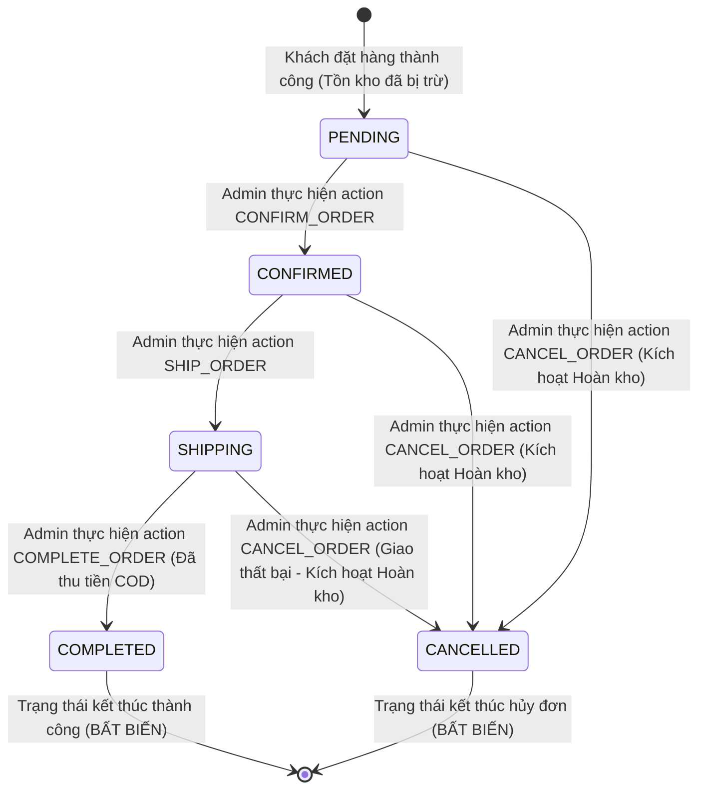

# QUY TẮC NGHIỆP VỤ HỆ THỐNG — SHOPVDK (BUSINESS RULES SPECIFICATIONS)

> **Mã tài liệu:** ANA-03  
> **Trạng thái:** Bản thảo phê duyệt (Draft)  
> **Giai đoạn:** Phase 02 — System Analysis & Modeling  
> **Dự án:** ShopVDK - Sports E-commerce Platform  

---

## 1. Mục Đích & Phạm Vi Áp Dụng

Tài liệu này chuẩn hóa toàn bộ các quy tắc bất biến (Business Invariants), định dạng dữ liệu đầu vào (Validation Constraints), logic quản lý tồn kho và ma trận chuyển trạng thái đơn hàng trong hệ thống ShopVDK. Mọi chức năng ở tầng Frontend (React) và Backend (Spring Boot 3.x) bắt buộc phải tuân thủ nghiêm ngặt các quy tắc này.

---

## 2. Danh Mục Quy Tắc Nghiệp Vụ Chi Tiết

### 2.1 NHÓM XÁC THỰC & NGƯỜI DÙNG (BR-AUTH)

| Mã Quy tắc | Tên Quy tắc | Mô tả chi tiết & Ràng buộc kỹ thuật | Áp dụng |
|---|---|---|---|
| **BR-AUTH-01** | **Định dạng Số điện thoại Việt Nam** | - Bắt buộc đúng **10 chữ số**.<br>- Bắt đầu bằng đầu số di động hợp lệ tại Việt Nam (`03`, `05`, `07`, `08`, `09`).<br>- **Regex chuẩn:** `^(0[3\|5\|7\|8\|9])[0-9]{8}$`. | Đăng ký, Đăng nhập, Checkout, Tra cứu đơn |
| **BR-AUTH-02** | **Định dạng & Tính Duy nhất của Email** | - Đúng định dạng chuẩn email RFC 5322.<br>- Độ dài tối đa 150 ký tự.<br>- Không phân biệt hoa thường (Case-insensitive) và **duy nhất (UNIQUE)** trong bảng `users`. | Đăng ký tài khoản, Profile |
| **BR-AUTH-03** | **Độ phức tạp Mật khẩu** | - Độ dài từ **8 đến 32 ký tự**.<br>- Chứa ít nhất: 1 chữ hoa, 1 chữ thường, 1 chữ số.<br>- Mật khẩu thô tuyệt đối không lưu DB; bắt buộc mã hóa bằng **BCrypt (Strength >= 10)**. | Đăng ký, Đổi mật khẩu |
| **BR-AUTH-04** | **Định danh Đăng nhập Linh hoạt** | - Trường `identifier` cho phép người dùng nhập **Số điện thoại HOẶC Email**.<br>- Backend thực hiện truy vấn kép: `WHERE (email = :id OR phone = :id) AND is_active = true`. | API Login `/api/auth/login` |
| **BR-AUTH-05** | **Khóa Tài khoản (Account Status)** | - Tài khoản có cờ `is_active = false` (bị khóa bởi Admin) sẽ bị từ chối đăng nhập với thông báo: *"Tài khoản của bạn đã bị tạm khóa, vui lòng liên hệ quản trị viên."* | Toàn hệ thống |

---

### 2.2 NHÓM DANH MỤC, SẢN PHẨM & MA TRẬN SKU (BR-CATALOG)

| Mã Quy tắc | Tên Quy tắc | Mô tả chi tiết & Ràng buộc kỹ thuật | Áp dụng |
|---|---|---|---|
| **BR-CAT-01** | **Quy chuẩn Định danh Sản phẩm (Slug)** | - Tạo tự động từ tên sản phẩm, chuyển thành chữ thường, không dấu, phân tách bằng dấu gạch ngang (`-`).<br>- Định dạng Regex: `^[a-z0-9]+(?:-[a-z0-9]+)*$`.<br>- **Duy nhất (UNIQUE)** trong toàn bộ bảng `products`. | Quản lý Sản phẩm |
| **BR-CAT-02** | **Định dạng Mã SKU Biến thể (SKU Code)** | - Mỗi biến thể bắt buộc có một mã SKU duy nhất (UNIQUE) trên toàn hệ thống.<br>- Cấu trúc khuyến nghị: `[MÃ_HÃNG]-[TÊN_RÚT_GỌN]-[BIẾN_THỂ]`.<br>- *Ví dụ Vợt:* `YNX-AX88D-4UG5` hoặc `VIC-TK99-3UG5`.<br>- *Ví dụ Giày:* `LNN-AYTU001-41`. | Quản lý Biến thể SKU |
| **BR-CAT-03** | **Quy tắc Giá bán (Pricing)** | - Giá gốc (`base_price`) và giá biến thể (`price`) bắt buộc phải là số dương: `price > 0`.<br>- Nếu sản phẩm có giá khuyến mãi (`sale_price`), bắt buộc `0 < sale_price <= price`. | Catalog & Bán hàng |
| **BR-CAT-04** | **Cấu trúc Thuộc tính Động (JSONB Schema)** | - Bảng `products`: Cột `specifications JSONB` lưu các thông số kỹ thuật chung (Balance, Stiffness, Player Level, Shoe Fit...).<br>- Bảng `product_variants`: Cột `attributes JSONB` lưu các thông số định danh SKU mà khách chọn mua (`weight`, `grip`, `size`, `color`).<br>- Mọi khóa (keys) trong JSON đều đặt theo chuẩn `snake_case`. | Backend Entity & DB |

---

### 2.3 NHÓM QUẢN LÝ TỒN KHO & CHỐNG BÁN ÂM (BR-INVENTORY)

```mermaid
flowchart TD
    Req[Khách xác nhận Đặt hàng] --> Lock[Pessimistic Lock: SELECT ... FOR UPDATE trên SKU]
    Lock --> CheckStock{Kiểm tra tồn kho thực tế}
    
    CheckStock -- "stock_quantity == 0" --> ErrOutOfStock[Giao dịch ROLLBACK<br/>HTTP 409 Conflict<br/>Báo lỗi: 'Sản phẩm [Tên - SKU] đã hết hàng']
    CheckStock -- "0 < stock_quantity < requested_qty" --> ErrInsufficient[Giao dịch ROLLBACK<br/>HTTP 409 Conflict<br/>Báo lỗi: 'Sản phẩm [Tên - SKU] chỉ còn lại [X] chiếc,<br/>không đủ số lượng bạn yêu cầu']
    CheckStock -- "stock_quantity >= requested_qty" --> Deduct[UPDATE stock_quantity = stock_quantity - qty]
    
    Deduct --> CreateOrder[INSERT INTO orders & order_items]
    CreateOrder --> Commit[COMMIT Giao dịch thành công]
```

| Mã Quy tắc | Tên Quy tắc | Mô tả chi tiết & Ràng buộc kỹ thuật | Áp dụng |
|---|---|---|---|
| **BR-INV-01** | **Trừ Kho Nguyên Tử (Atomic Deduction)** | - Quá trình kiểm tra và trừ kho phải thực thi bên trong giao dịch `@Transactional`.<br>- Bắt buộc sử dụng khóa bi quan (`Pessimistic Lock - SELECT ... FOR UPDATE`) trên bản ghi `product_variants` để ngăn chặn triệt để tình trạng tranh chấp dữ liệu (Race Condition) khi nhiều khách cùng mua 1 cây vợt cuối cùng. | Đặt hàng (Checkout) |
| **BR-INV-02** | **Nguyên tắc Tuyệt đối Chống Bán Âm & Phân Nhánh Báo Lỗi Tồn Kho** | - Ràng buộc mức Database: `CHECK (stock_quantity >= 0)`.<br>- Hệ thống chia nhánh thông báo lỗi rõ ràng theo 2 kịch bản ngoại lệ để tối ưu UX cho khách hàng:<br>  1. **Khi `stock_quantity == 0` (Hết hàng hoàn toàn):** Ném `OutOfStockException`, trả về lỗi: *"Sản phẩm [Tên sản phẩm - SKU] đã hết hàng."*<br>  2. **Khi `0 < stock_quantity < requested_quantity` (Không đủ số lượng đặt):** Ném `InsufficientStockException`, trả về lỗi: *"Sản phẩm [Tên sản phẩm - SKU] chỉ còn lại [X] chiếc, không đủ số lượng bạn yêu cầu."*<br>- Cả hai trường hợp đều lập tức **ROLLBACK** toàn bộ giao dịch, giữ nguyên giỏ hàng Client để khách kịp thời điều chỉnh số lượng hoặc chọn biến thể khác. | Đặt hàng (Checkout) |
| **BR-INV-03** | **Tự Động Hoàn Kho khi Hủy Đơn (Auto-Restock)** | - Khi đơn hàng chuyển sang trạng thái `CANCELLED` (từ `PENDING`, `CONFIRMED` hoặc `SHIPPING`), hệ thống **bắt buộc tự động cộng hoàn lại** số lượng vào `stock_quantity` của từng biến thể SKU tương ứng bên trong cùng một `@Transactional`. | Hủy đơn hàng |

---

### 2.4 NHÓM ĐẶT HÀNG & MA TRẬN TRẠNG THÁI (BR-ORDER)

| Mã Quy tắc | Tên Quy tắc | Mô tả chi tiết & Ràng buộc kỹ thuật | Áp dụng |
|---|---|---|---|
| **BR-ORD-01** | **Quyền Mua Hàng Khách Vãng Lai (Guest Checkout)** | - Bảng `orders` cho phép cột `user_id = NULL`.<br>- Không bắt buộc đăng nhập để đặt hàng. | Đặt hàng |
| **BR-ORD-02** | **Bảo toàn Thông tin Snapshot** | - Bảng `orders` bắt buộc lưu bản sao trực tiếp (Snapshot) của: `recipient_name`, `recipient_phone`, `recipient_email`, `shipping_address`, `order_notes`.<br>- Bảng `order_items` bắt buộc lưu `price_at_purchase` (giá tại thời điểm mua), đảm bảo nếu sau này giá sản phẩm tăng/giảm thì đơn hàng cũ không bị đổi giá. | Đặt hàng |
| **BR-ORD-03** | **Quy chuẩn Sinh Mã Đơn Hàng (Order Code)** | - Mã đơn hàng duy nhất toàn hệ thống, thân thiện cho con người đọc và tra cứu.<br>- Cấu trúc: `VDK-YYYYMMDD-[4 KÝ TỰ NGẪU NHIÊN CHỮ VÀ SỐ]`.<br>- *Ví dụ:* `VDK-20261114-8A3F`. Tuyệt đối không dùng ID tăng dần (`1, 2, 3...`) để tránh lộ số lượng đơn hàng của shop. | Đặt hàng, Tra cứu |

---

### 2.5 MA TRẬN CHUYỂN TRẠNG THÁI ĐƠN HÀNG (ORDER STATE TRANSITION MATRIX)



#### Bảng Kiểm Soát Hợp Lệ Chuyển Trạng Thái (State Transition Table)

| Trạng thái Hiện tại (From) | Trạng thái Đích (To) | Lệnh Hệ Thống (Trigger Action) | Người thực hiện | Hợp lệ? | Xử lý kèm theo |
|---|---|---|---|---|---|
| **Mới tạo** | `PENDING` | `CREATE_ORDER` | Khách (Guest/Member) | ✅ Hợp lệ | Trừ kho tức thời (`stock - qty`) |
| `PENDING` | `CONFIRMED` | `CONFIRM_ORDER` | Admin | ✅ Hợp lệ | Chuyển đơn sang khâu chuẩn bị hàng |
| `PENDING` | `CANCELLED` | `CANCEL_ORDER` | Admin / Khách | ✅ Hợp lệ | **Bắt buộc nhập lý do hủy + Tự động hoàn kho** |
| `PENDING` | `SHIPPING` | `SHIP_ORDER` | Admin | ❌ **Bất hợp lệ** | Không được nhảy cóc qua `CONFIRMED` |
| `PENDING` | `COMPLETED` | `COMPLETE_ORDER` | Admin | ❌ **Bất hợp lệ** | Không được nhảy cóc |
| `CONFIRMED` | `SHIPPING` | `SHIP_ORDER` | Admin | ✅ Hợp lệ | Bàn giao đơn vị vận chuyển |
| `CONFIRMED` | `CANCELLED` | `CANCEL_ORDER` | Admin | ✅ Hợp lệ | **Bắt buộc nhập lý do hủy + Tự động hoàn kho** |
| `SHIPPING` | `COMPLETED` | `COMPLETE_ORDER` | Admin | ✅ Hợp lệ | Thu tiền COD thành công, hoàn tất đơn |
| `SHIPPING` | `CANCELLED` | `CANCEL_ORDER` | Admin | ✅ Hợp lệ | Giao thất bại / bom hàng: **Tự động hoàn kho** |
| `COMPLETED` | *Bất kỳ trạng thái nào* | - | - | ❌ **Bất hợp lệ** | **Bất biến (Immutable):** Đơn đã hoàn tất không thể đổi trạng thái |
| `CANCELLED` | *Bất kỳ trạng thái nào* | - | - | ❌ **Bất hợp lệ** | **Bất biến (Immutable):** Đơn đã hủy không thể mở lại (tránh sai lệch kho) |

---

### 2.6 NHÓM TRA CỨU ĐƠN HÀNG CÔNG KHAI (BR-TRACKING)

| Mã Quy tắc | Tên Quy tắc | Mô tả chi tiết & Ràng buộc kỹ thuật | Áp dụng |
|---|---|---|---|
| **BR-TRK-01** | **Xác thực Kép khi Tra cứu Công khai** | - API tra cứu `/api/orders/track` bắt buộc truyền cả `order_code` và `recipient_phone`.<br>- Câu lệnh SQL: `WHERE order_code = :orderCode AND recipient_phone = :phone`. | Tra cứu đơn hàng |
| **BR-TRK-02** | **Bảo vệ Chống Quét Dữ liệu (Information Leakage Prevention)** | - Nếu không tìm thấy hoặc sai 1 trong 2 thông tin, hệ thống **chỉ trả về một thông báo lỗi duy nhất**: *"Thông tin tra cứu không chính xác hoặc không tồn tại."*<br>- Tuyệt đối không trả về thông báo dạng *"Mã đơn đúng nhưng số điện thoại sai"* để tránh bị kẻ xấu lợi dụng dò quét số điện thoại của khách hàng. | Tra cứu đơn hàng |

