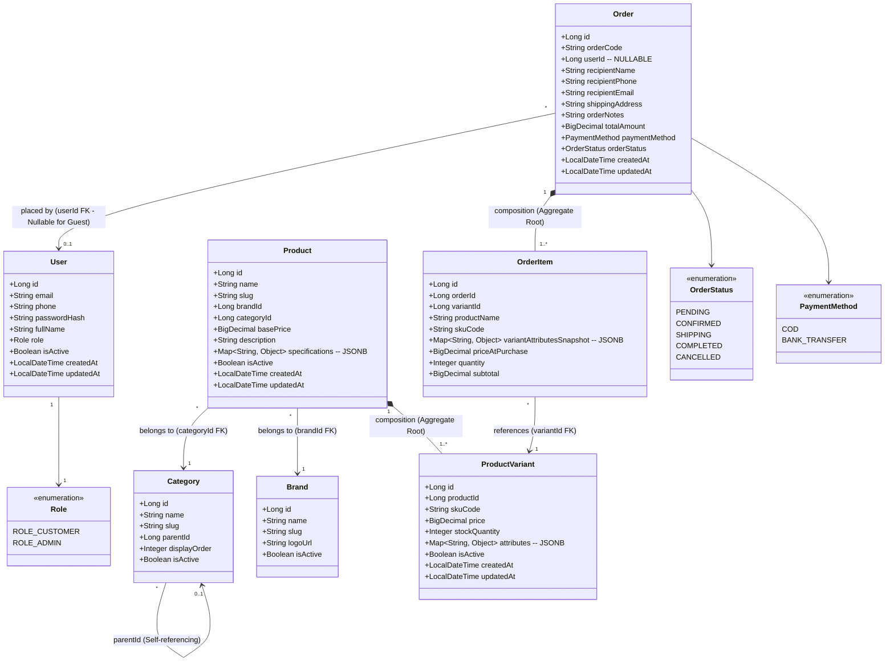

# MÔ HÌNH THỰC THỂ MIỀN — SHOPVDK (DOMAIN MODEL SPECIFICATION)

> **Mã tài liệu:** ANA-04  
> **Trạng thái:** Bản thảo phê duyệt (Draft)  
> **Giai đoạn:** Phase 02 — System Analysis & Modeling  
> **Dự án:** ShopVDK - Sports E-commerce Platform  

---

## 1. Sơ Đồ Thực Thể Miền Tổng Thể (Domain Class Diagram)

Mô hình hướng đối tượng của ShopVDK được tổ chức xoay quanh 3 Cụm thực thể (Aggregates) cốt lõi: **User**, **Catalog (Product & Variant)** và **Order**:

---

## 2. Chi Tiết Các Thực Thể Miền (Domain Entities)

### 2.1 CỤM QUẢN LÝ TÀI KHOẢN (USER AGGREGATE)

#### Thực thể `User` (Aggregate Root)
- **Mục đích:** Quản lý thông tin định danh và phân quyền của tài khoản thành viên và quản trị viên.
- **Thuộc tính cốt lõi:**
  - `id`: Định danh duy nhất (Surrogate Primary Key - Long / BIGINT).
  - `email`: Địa chỉ email, định dạng RFC 5322, duy nhất (`UNIQUE`), không phân biệt hoa thường.
  - `phone`: Số điện thoại di động Việt Nam 10 chữ số, duy nhất (`UNIQUE`), dùng làm định danh đăng nhập kép.
  - `passwordHash`: Chuỗi mã hóa BCrypt của mật khẩu (không lưu văn bản thô).
  - `fullName`: Họ và tên hiển thị của người dùng.
  - `role`: Phân quyền người dùng (`ROLE_CUSTOMER` hoặc `ROLE_ADMIN`).
  - `isActive`: Cờ kích hoạt tài khoản (`true` = hoạt động, `false` = bị khóa).

---

### 2.2 CỤM DANH MỤC & SẢN PHẨM (CATALOG AGGREGATE)

#### 1. Thực thể `Category`
- **Mục đích:** Quản lý cấu trúc cây danh mục sản phẩm (Cầu lông -> Vợt, Giày, Quần áo, Túi/Balo, Cước, Phụ kiện).
- **Thuộc tính:**
  - `id`: Khóa chính.
  - `name`: Tên danh mục (ví dụ: *Vợt Cầu Lông*, *Giày Cầu Lông*).
  - `slug`: Chuỗi định danh URL thân thiện chuẩn SEO (ví dụ: `vot-cau-long`), duy nhất (`UNIQUE`).
  - `parentId`: Khóa ngoại tự tham chiếu (`self-referencing FK`) trỏ đến danh mục cha. Giá trị `NULL` đại diện cho danh mục gốc (Cầu lông).
  - `displayOrder`: Thứ tự sắp xếp trên thanh Menu.
  - `isActive`: Cờ ẩn/hiện danh mục trên trang Storefront.

#### 2. Thực thể `Brand`
- **Mục đích:** Quản lý danh sách các thương hiệu thể thao chính hãng.
- **Thuộc tính:**
  - `id`: Khóa chính.
  - `name`: Tên thương hiệu (ví dụ: *Yonex, Victor, Lining, Mizuno, Apacs...*).
  - `slug`: Định danh URL (ví dụ: `yonex`, `lining`), duy nhất (`UNIQUE`).
  - `logoUrl`: Đường dẫn ảnh logo của thương hiệu.

#### 3. Thực thể `Product` (Aggregate Root)
- **Mục đích:** Đại diện cho sản phẩm trừu tượng cha trong catalog.
- **Thuộc tính:**
  - `id`: Khóa chính.
  - `name`: Tên đầy đủ của sản phẩm (ví dụ: *Vợt Cầu Lông Yonex Astrox 88D Pro*).
  - `slug`: URL slug duy nhất (`UNIQUE`) cho trang chi tiết `/products/:slug`.
  - `brandId`: Khóa ngoại liên kết tới thương hiệu sản xuất.
  - `categoryId`: Khóa ngoại liên kết tới danh mục trực tiếp.
  - `basePrice`: Giá bán cơ sở tham khảo.
  - `description`: Bài viết mô tả chi tiết, hướng dẫn sử dụng, đánh giá công nghệ.
  - **`specifications` (Kiểu PostgreSQL `JSONB`):**
    - Chứa toàn bộ các thông số kỹ thuật dùng để hiển thị tab thông số và bộ lọc Facet Filter:
    - *Ví dụ Vợt:* `{"balance": "head-heavy", "stiffness": "stiff", "play_style": "attack", "game_type": "doubles", "player_level": "advanced"}`.
    - *Ví dụ Giày:* `{"shoe_fit": "wide", "surface_type": "all", "tier": "high-end", "highlights": ["anti-torsion", "cushion"]}`.

#### 4. Thực thể `ProductVariant` (SKU - Stock Keeping Unit)
- **Mục đích:** Đại diện cho một phiên bản vật lý cụ thể trong kho hàng mà khách hàng bấm chọn để mua.
- **Thuộc tính:**
  - `id`: Khóa chính.
  - `productId`: Khóa ngoại liên kết tới sản phẩm cha `Product`.
  - `skuCode`: Mã SKU duy nhất (`UNIQUE`) toàn hệ thống (ví dụ: `YNX-AX88D-4UG5`).
  - `price`: Giá bán thực tế của biến thể này (cho phép các bản nặng hơn hoặc size đặc biệt có giá chênh lệch).
  - `stockQuantity`: Số lượng tồn kho thực tế có sẵn (`CHECK (stock_quantity >= 0)`).
  - **`attributes` (Kiểu PostgreSQL `JSONB`):**
    - Chứa các thuộc tính định danh phiên bản mà người mua lựa chọn:
    - *Ví dụ Vợt:* `{"weight": "4U", "grip": "G5"}`.
    - *Ví dụ Giày:* `{"size": "41"}`.
    - *Ví dụ Áo:* `{"size": "L", "color": "Navy"}`.

---

### 2.3 CỤM ĐƠN HÀNG (ORDER AGGREGATE)

#### 1. Thực thể `Order` (Aggregate Root)
- **Mục đích:** Đại diện cho một đơn đặt hàng của khách hàng (hỗ trợ cả Khách vãng lai lẫn Thành viên).
- **Thuộc tính:**
  - `id`: Khóa chính.
  - `orderCode`: Mã đơn hàng duy nhất cho con người tra cứu (ví dụ: `VDK-20261114-8A3F`).
  - **`userId` (NULLABLE):** Khóa ngoại tới `User`. Có giá trị `NULL` khi là **Guest Checkout** (Khách vãng lai); có giá trị `ID` khi là khách có tài khoản.
  - **Nhóm thông tin Snapshot người nhận (Bất biến):**
    - `recipientName`: Họ tên người nhận tại thời điểm đặt hàng.
    - `recipientPhone`: Số điện thoại nhận hàng (dùng để tra cứu đơn).
    - `recipientEmail`: Email nhận hóa đơn và thông báo.
    - `shippingAddress`: Địa chỉ giao hàng đầy đủ.
    - `orderNotes`: Ghi chú riêng của người đặt (tùy chọn).
  - `totalAmount`: Tổng tiền thanh toán của đơn hàng (bao gồm tiền hàng + phụ phí).
  - `paymentMethod`: Phương thức thanh toán (`COD` hoặc `BANK_TRANSFER`).
  - `orderStatus`: Trạng thái vòng đời đơn (`PENDING`, `CONFIRMED`, `SHIPPING`, `COMPLETED`, `CANCELLED`).

#### 2. Thực thể `OrderItem`
- **Mục đích:** Chi tiết từng dòng sản phẩm biến thể nằm trong đơn hàng.
- **Thuộc tính:**
  - `id`: Khóa chính.
  - `orderId`: Khóa ngoại liên kết tới đơn hàng cha `Order`.
  - `variantId`: Khóa ngoại tham chiếu tới `ProductVariant`.
  - **Nhóm thông tin Snapshot sản phẩm (Bảo toàn lịch sử mua hàng):**
    - `productName`: Tên sản phẩm tại thời điểm mua.
    - `skuCode`: Mã SKU tại thời điểm mua.
    - `variantAttributesSnapshot`: Bản sao JSONB các thuộc tính biến thể (ví dụ: `{"weight": "4U", "grip": "G5"}`).
    - `priceAtPurchase`: Đơn giá mua thực tế tại thời điểm chốt đơn (đảm bảo sau này giá niêm yết có đổi thì đơn cũ vẫn giữ giá cũ).
    - `quantity`: Số lượng đặt mua (`quantity > 0`).
    - `subtotal`: Thành tiền dòng sản phẩm (`priceAtPurchase * quantity`).

---

## 3. Ràng Buộc Miền & Nguyên Tắc Độc Lập Dữ Liệu (Domain Invariants)

1. **Nguyên tắc Toàn vẹn Lịch sử (Historical Data Immutability):**
   - Khi một `Order` và các `OrderItem` được tạo thành công, toàn bộ thông tin người nhận và giá bán được snapshot vĩnh viễn. Dù tài khoản người dùng có đổi tên/địa chỉ, hoặc sản phẩm cha có bị xóa/sửa giá, dữ liệu đơn hàng trong quá khứ tuyệt đối không bị ảnh hưởng.
2. **Nguyên tắc Tồn kho Nguyên tử (Atomic Inventory Invariant):**
   - Không một dòng `OrderItem` nào được phép tạo ra nếu `product_variants.stock_quantity < order_item.quantity`.
   - Việc trừ kho khi tạo đơn và hoàn kho khi hủy đơn là trách nhiệm của Aggregate `Order` thông qua giao dịch `@Transactional`.
3. **Nguyên tắc Mở rộng Đa môn Thể thao (Multi-Sport Open Extension):**
   - Cặp cột `JSONB` (`products.specifications` và `product_variants.attributes`) là chìa khóa giúp miền dữ liệu Cầu lông mở rộng sang Tennis, Pickleball trong tương lai mà không cần chạm vào mã nguồn của các Entities JPA.

