# ĐẶC TẢ CA SỬ DỤNG — SHOPVDK (USE-CASE SPECIFICATIONS)

> **Mã tài liệu:** ANA-01  
> **Trạng thái:** Bản thảo phê duyệt (Draft)  
> **Giai đoạn:** Phase 02 — System Analysis & Modeling  
> **Dự án:** ShopVDK - Sports E-commerce Platform  

---

## 1. Sơ đồ Use-Case Tổng thể (System Use-Case Diagram)

Hệ thống ShopVDK gồm 3 tác nhân chính tương tác với 5 phân hệ ca sử dụng:

```mermaid
flowchart TD
    %% Actors
    Guest((Khách vãng lai))
    Customer((Khách hàng thành viên))
    Admin((Quản trị viên))
    
    Customer -.->|Kế thừa quyền xem| Guest
    
    subgraph UC_CATALOG [Phân hệ Xem Hàng & Tìm Kiếm Cầu Lông]
        UC_CAT01[UC-CAT-01: Xem Danh mục & Lưới Sản phẩm]
        UC_CAT02[UC-CAT-02: Lọc Động theo Danh mục]
        UC_CAT03[UC-CAT-03: Xem Chi tiết & Chọn Biến thể SKU]
        UC_CAT04[UC-CAT-04: Tìm kiếm Sản phẩm]
    end

    subgraph UC_CART [Phân hệ Giỏ Hàng]
        UC_CART01[UC-CART-01: Thêm SKU vào Giỏ]
        UC_CART02[UC-CART-02: Cập nhật Số lượng Giỏ]
        UC_CART03[UC-CART-03: Xóa Món khỏi Giỏ]
    end

    subgraph UC_ORDER [Phân hệ Đặt Hàng & Tra Cứu]
        UC_ORD01[UC-ORD-01: Đặt hàng Khách vãng lai - Guest Checkout]
        UC_ORD02[UC-ORD-02: Đặt hàng Thành viên - Member Checkout]
        UC_ORD03[UC-ORD-03: Tra cứu Đơn hàng công khai bằng Mã + SĐT]
        UC_ORD04[UC-ORD-04: Xem Lịch sử Đơn hàng Cá nhân]
    end

    subgraph UC_AUTH [Phân hệ Xác Thực]
        UC_AUTH01[UC-AUTH-01: Đăng ký Tài khoản]
        UC_AUTH02[UC-AUTH-02: Đăng nhập Hệ thống]
        UC_AUTH03[UC-AUTH-03: Quản lý Hồ sơ & Sổ địa chỉ]
    end

    subgraph UC_ADMIN [Phân hệ Quản Trị Vận Hành]
        UC_ADM01[UC-ADM-01: Xem Dashboard Thống kê]
        UC_ADM02[UC-ADM-02: Quản lý Danh mục & Thương hiệu]
        UC_ADM03[UC-ADM-03: Quản lý Sản phẩm & Ma trận SKU]
        UC_ADM04[UC-ADM-04: Tiếp nhận & Chuyển Trạng thái Đơn hàng]
    end

    %% Interactions
    Guest --> UC_CAT01
    Guest --> UC_CAT02
    Guest --> UC_CAT03
    Guest --> UC_CAT04
    Guest --> UC_CART01
    Guest --> UC_CART02
    Guest --> UC_CART03
    Guest --> UC_ORD01
    Guest --> UC_ORD03
    Guest --> UC_AUTH01
    Guest --> UC_AUTH02

    Customer --> UC_ORD02
    Customer --> UC_ORD04
    Customer --> UC_AUTH03

    Admin --> UC_ADM01
    Admin --> UC_ADM02
    Admin --> UC_ADM03
    Admin --> UC_ADM04
```

---

## 2. Danh mục Ca Sử Dụng Chi Tiết (Use-Case Inventory)

| Mã Use-case | Tên Ca Sử Dụng | Tác nhân chính | Mức độ ưu tiên |
|---|---|---|---|
| **UC-CAT-01** | Xem danh mục và lưới sản phẩm cầu lông | Guest, Customer | Bắt buộc (MVP) |
| **UC-CAT-02** | Lọc động theo thông số danh mục (U, cán, độ cứng, size) | Guest, Customer | Bắt buộc (MVP) |
| **UC-CAT-03** | Xem chi tiết sản phẩm và chọn biến thể SKU | Guest, Customer | Bắt buộc (MVP) |
| **UC-CAT-04** | Tìm kiếm sản phẩm theo từ khóa | Guest, Customer | Bắt buộc (MVP) |
| **UC-CART-01** | Thêm sản phẩm biến thể (SKU) vào giỏ hàng | Guest, Customer | Bắt buộc (MVP) |
| **UC-CART-02** | Xem và cập nhật số lượng món trong giỏ | Guest, Customer | Bắt buộc (MVP) |
| **UC-CART-03** | Xóa sản phẩm khỏi giỏ hàng | Guest, Customer | Bắt buộc (MVP) |
| **UC-ORD-01** | **Đặt hàng Khách vãng lai (Guest Checkout — không cần tài khoản)** | Guest | **Cốt lõi (MVP)** |
| **UC-ORD-02** | Đặt hàng Thành viên (Member Checkout) | Customer | Bắt buộc (MVP) |
| **UC-ORD-03** | **Tra cứu đơn hàng công khai bằng Mã đơn + SĐT** | Guest, Customer | **Cốt lõi (MVP)** |
| **UC-ORD-04** | Xem lịch sử đơn hàng của tài khoản | Customer | Bắt buộc (MVP) |
| **UC-AUTH-01** | Đăng ký tài khoản thành viên mới | Guest | Bắt buộc (MVP) |
| **UC-AUTH-02** | Đăng nhập hệ thống & nhận JWT | Guest, Admin | Bắt buộc (MVP) |
| **UC-AUTH-03** | Xem & Cập nhật thông tin cá nhân | Customer | Khuyến nghị (MVP) |
| **UC-ADM-01** | Xem Dashboard chỉ số kinh doanh | Admin | Bắt buộc (MVP) |
| **UC-ADM-02** | Quản lý Danh mục & Thương hiệu | Admin | Bắt buộc (MVP) |
| **UC-ADM-03** | Quản lý Sản phẩm & Thiết lập Ma trận SKU | Admin | **Cốt lõi (MVP)** |
| **UC-ADM-04** | Xử lý và Chuyển trạng thái đơn hàng (Order Fulfillment) | Admin | **Cốt lõi (MVP)** |

---

## 3. Đặc tả Chi tiết Các Ca Sử Dụng Trọng Tâm (Core Use-Case Specs)

### 3.1 UC-ORD-01: Đặt Hàng Khách Vãng Lai (Guest Checkout)

- **Mô tả tóm tắt:** Khách vãng lai chưa có tài khoản có thể mua sắm và tạo đơn hàng thành công trực tiếp chỉ bằng việc điền thông tin người nhận và chọn phương thức thanh toán.
- **Tác nhân chính:** Khách vãng lai (Guest).
- **Tiền điều kiện (Preconditions):**
  - Giỏ hàng của khách đang có ít nhất 1 sản phẩm biến thể (SKU).
  - Các mặt hàng trong giỏ đều còn tồn kho hợp lệ.
- **Hậu điều kiện (Postconditions):**
  - Đơn hàng mới được tạo trong bảng `orders` với trạng thái `PENDING` và `user_id = NULL`.
  - Toàn bộ thông tin người nhận được snapshot trực tiếp vào đơn hàng.
  - Tồn kho của các SKU trong đơn lập tức bị trừ tương ứng.
  - Giỏ hàng của khách được làm trống.
  - Khách nhận được Mã đơn hàng duy nhất (`orderCode`).
- **Luồng sự kiện chính (Happy Path):**
  1. Khách từ trang `/cart` bấm nút "Tiến hành Đặt hàng".
  2. Hệ thống chuyển hướng khách đến trang `/checkout`.
  3. Khách nhập các trường thông tin bắt buộc:
     - Họ và tên người nhận (`recipient_name`)
     - Số điện thoại nhận hàng (`recipient_phone`)
     - Địa chỉ Email (`recipient_email`)
     - Địa chỉ giao hàng chi tiết (`shipping_address`: Tỉnh/Thành, Quận/Huyện, Phường/Xã, Số nhà/Đường)
     - Ghi chú đơn hàng (`order_notes` - không bắt buộc)
  4. Khách chọn Phương thức thanh toán: **COD** hoặc **Chuyển khoản ngân hàng**.
  5. Khách nhấn "Xác nhận Đặt hàng".
  6. Hệ thống thực hiện giao dịch `@Transactional`:
     - Kiểm tra lại tồn kho thời gian thực của từng SKU.
     - Trừ số lượng tồn kho của các SKU tương ứng.
     - Tạo bản ghi trong bảng `orders` (sinh mã `order_code`, lưu snapshot thông tin nhận hàng, gán `user_id = NULL`, trạng thái `PENDING`).
     - Tạo các bản ghi chi tiết đơn hàng trong `order_items`.
  7. Hệ thống chuyển hướng khách đến trang `/orders/success/:orderCode`.
  8. Hệ thống hiển thị thông tin tóm tắt đơn hàng và hướng dẫn thanh toán (nếu chọn Chuyển khoản ngân hàng).
- **Luồng thay thế & Xử lý ngoại lệ (Alternative / Exception Flows):**
  - *3a. Dữ liệu nhập không hợp lệ:* SĐT sai định dạng, thiếu Tên hoặc Địa chỉ -> Hệ thống hiển thị thông báo lỗi tại từng ô nhập liệu, ngăn không cho bấm Đặt hàng.
  - *6a. Tồn kho hết hoàn toàn (stock_quantity == 0):* Giao dịch tự động Rollback, hệ thống hiển thị cảnh báo: *"Sản phẩm [Tên sản phẩm - SKU] đã hết hàng"*, giữ nguyên giỏ hàng để khách chọn biến thể khác.
  - *6b. Tồn kho không đủ số lượng (0 < stock_quantity < requested_qty):* Giao dịch tự động Rollback, hệ thống hiển thị cảnh báo: *"Sản phẩm [Tên sản phẩm - SKU] chỉ còn lại [X] chiếc, không đủ số lượng bạn yêu cầu"*, gợi ý khách điều chỉnh số lượng mua xuống mức tối đa có sẵn.

---

### 3.2 UC-ORD-03: Tra Cứu Đơn Hàng Công Khai (Public Order Lookup)

- **Mô tả tóm tắt:** Cho phép bất kỳ ai có Mã đơn hàng và Số điện thoại khớp nhau đều có thể xem tiến độ và chi tiết đơn hàng mà không cần đăng nhập hay Token xác thực.
- **Tác nhân chính:** Khách vãng lai (Guest).
- **Tiền điều kiện:** Khách có trong tay Mã đơn hàng (`orderCode`) và Số điện thoại đã dùng để đặt đơn.
- **Hậu điều kiện:** Không làm thay đổi trạng thái dữ liệu (Read-only).
- **Luồng sự kiện chính (Happy Path):**
  1. Khách truy cập vào trang `/orders/track`.
  2. Khách nhập: `Mã đơn hàng` (ví dụ `VDK-20261113-1024`) và `Số điện thoại nhận hàng`.
  3. Khách bấm "Tra cứu".
  4. Backend kiểm tra điều kiện truy vấn:
     `SELECT * FROM orders WHERE order_code = :orderCode AND recipient_phone = :phone`.
  5. Hệ thống tìm thấy đơn hàng khớp chính xác cả 2 tiêu chí.
  6. Hệ thống trả về chi tiết đơn hàng: Mã đơn, ngày đặt, trạng thái hiện tại (`PENDING`, `CONFIRMED`, `SHIPPING`, `COMPLETED`, `CANCELLED`), danh sách sản phẩm kèm biến thể, số lượng, tổng tiền và địa chỉ giao hàng.
  7. Giao diện hiển thị thanh tiến trình trực quan (Order Timeline).
- **Luồng ngoại lệ (Exception Flows):**
  - *5a. Không tìm thấy đơn hàng:* Mã đơn hoặc SĐT không khớp -> Hệ thống hiển thị thông báo: "Không tìm thấy thông tin đơn hàng phù hợp. Vui lòng kiểm tra lại Mã đơn và Số điện thoại đặt hàng."

---

### 3.3 UC-CAT-02: Lọc Động Theo Danh Mục (Category-specific Dynamic Filtering)

- **Mô tả tóm tắt:** Thanh bộ lọc bên trái (Sidebar Filter) tự động thay đổi các tiêu chí lọc kỹ thuật 2 lớp (Lớp bộ lọc chung và Lớp bộ lọc chuyên biệt) dựa trên danh mục sản phẩm cầu lông mà khách hàng đang xem (sử dụng khả năng truy vấn PostgreSQL `JSONB`).
- **Tác nhân:** Khách vãng lai, Khách hàng.
- **Luồng sự kiện chính (Ví dụ duyệt Vợt cầu lông):**
  1. Khách chọn danh mục *Vợt cầu lông* (`/categories/vot-cau-long`).
  2. Giao diện tải về cấu hình bộ lọc 2 lớp chuẩn hóa:
     - **Lớp bộ lọc chung:** Thương hiệu (Yonex, Victor, Lining...), Mức giá (<500k, 500k-1tr, 1-2tr, 2-3tr, >3tr), Tình trạng hàng (Còn hàng).
     - **Lớp bộ lọc chuyên biệt Vợt:**
       - Trọng lượng nhóm U/F/2F: `2U, 3U, 4U, 5U, F, 2F`
       - Điểm cân bằng: *Nhẹ đầu, Cân bằng, Hơi nặng đầu, Nặng đầu*
       - Độ cứng đũa: *Dẻo, Trung bình, Cứng, Siêu cứng*
       - Phong cách chơi: *Tấn công, Công thủ toàn diện, Phòng thủ/phản tạt*
       - Nội dung chơi: *Đánh đơn, Đánh đôi, Cả hai*
       - Trình độ chơi: *Mới chơi, Trung bình (phong trào), Khá/Tốt, Chuyên nghiệp*
  3. Khách tích chọn một hoặc nhiều tiêu chí (ví dụ: Hãng = Yonex, Trọng lượng = 4U, Điểm cân bằng = Hơi nặng đầu, Nội dung = Đánh đôi).
  4. Frontend gửi yêu cầu lọc về Backend:
     `/api/products?category=vot-cau-long&brand=yonex&weight=4U&balance=slightly-head-heavy&game_type=doubles`.
  5. Backend thực hiện câu lệnh SQL sử dụng toán tử JSONB containment (`@>`) kết hợp chỉ mục GIN trên PostgreSQL.
  6. Hệ thống trả về danh sách sản phẩm thỏa mãn điều kiện với thời gian phản hồi < 200ms.
- **Luồng chuyển đổi ngữ cảnh danh mục:**
  - *1a. Khách chuyển sang danh mục Giày cầu lông (`/categories/giay-cau-long`):*
    Sidebar lập tức chuyển sang: *Size giày EU (36-45), Đối tượng (Nam/Nữ/Trẻ em/Unisex), Form giày (Slim/Unisex/Wide), Điểm nổi bật (Bám sân/Chống lật cổ chân/Đệm êm), Thể loại chơi (Trong nhà/Ngoài trời), Phân khúc (Giá rẻ/Trung cấp/Cao cấp)*.
  - *1b. Khách chuyển sang danh mục Túi vợt hoặc Balo cầu lông:*
    Sidebar chuyển sang: *Túi vợt (Số ngăn lớn: 1-3 ngăn, Thể loại túi, Điểm nổi bật cách nhiệt/ngăn giày)* hoặc *Balo (Thể loại balo, Điểm nổi bật ngăn vợt/ngăn giày)*.

---

### 3.4 UC-ADM-04: Xử Lý & Chuyển Trạng Thái Đơn Hàng (Order State Management)

- **Mô tả tóm tắt:** Quản trị viên kiểm tra đơn, gọi điện xác nhận và chuyển đổi trạng thái đơn hàng theo đúng vòng đời, bảo đảm tồn kho được xử lý chính xác.
- **Tác nhân:** Quản trị viên (Admin).
- **Tiền điều kiện:** Admin đã đăng nhập với quyền `ROLE_ADMIN`.
- **Luồng sự kiện chính:**
  1. Admin vào trang `/admin/orders`, chọn một đơn hàng ở trạng thái `PENDING`.
  2. Admin kiểm tra thông tin người nhận và danh sách sản phẩm.
  3. Sau khi xác nhận với khách, Admin bấm "Xác nhận đơn hàng" -> Trạng thái chuyển thành `CONFIRMED`.
  4. Khi đóng gói xong và bàn giao cho bưu tá, Admin bấm "Giao hàng" -> Trạng thái chuyển thành `SHIPPING`.
  5. Khi bưu tá thu tiền và giao thành công, Admin bấm "Hoàn tất" -> Trạng thái chuyển thành `COMPLETED`.
- **Luồng xử lý Hủy đơn & Hoàn kho (Order Cancellation Flow):**
  - Nếu khách yêu cầu hủy đơn hoặc không thể liên lạc được (ở trạng thái `PENDING` hoặc `CONFIRMED`):
  - Admin bấm "Hủy đơn hàng" và nhập lý do hủy.
  - Hệ thống thực hiện `@Transactional`:
    - Chuyển trạng thái đơn thành `CANCELLED`.
    - **Tự động cộng hoàn trả lại số lượng tồn kho** cho các biến thể SKU có trong đơn hàng đó.
    - Ghi nhận lịch sử thao tác hủy đơn.

