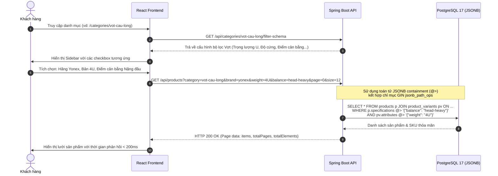
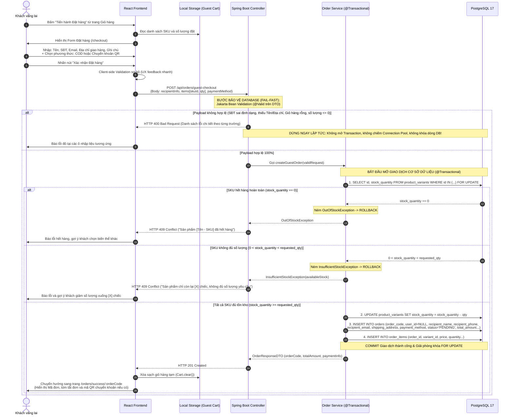
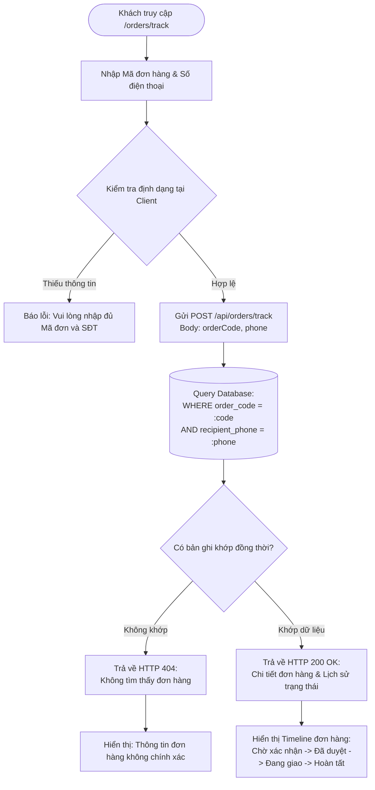
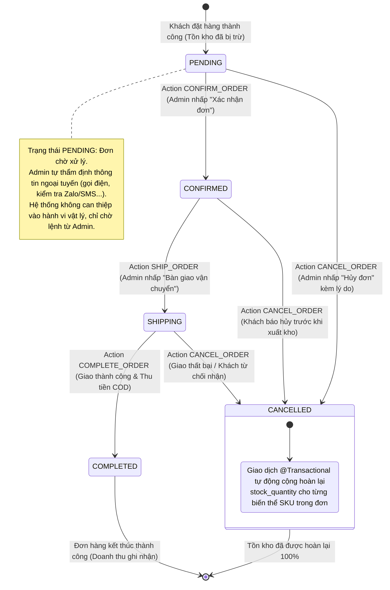
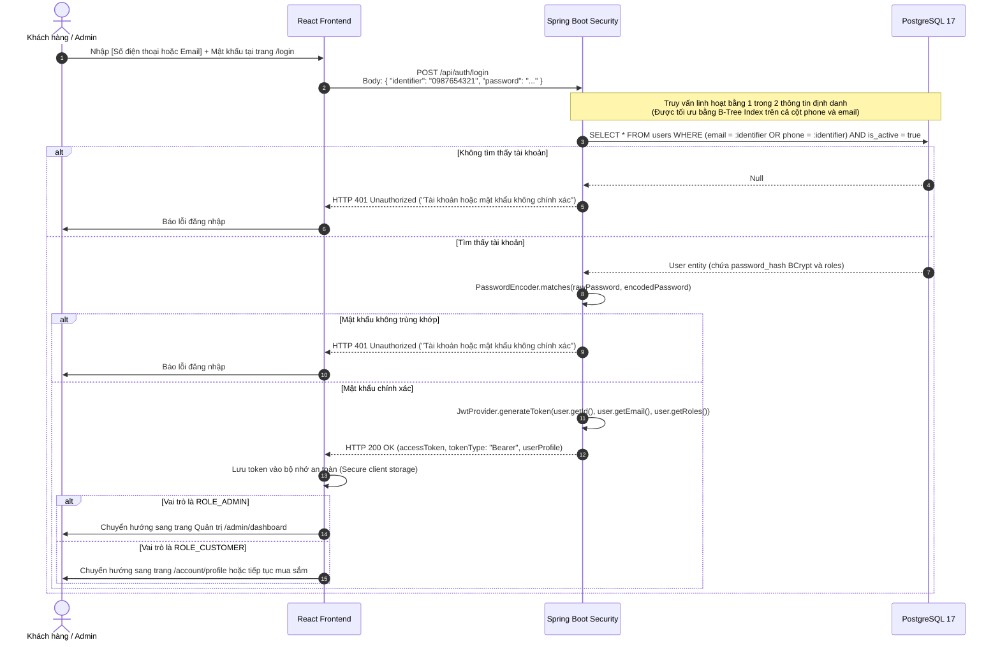

# SƠ ĐỒ LUỒNG NGƯỜI DÙNG VÀ HOẠT ĐỘNG HỆ THỐNG — SHOPVDK (USER FLOWS & SYSTEM WORKFLOWS)

> **Mã tài liệu:** ANA-02  
> **Trạng thái:** Bản thảo phê duyệt (Draft)  
> **Giai đoạn:** Phase 02 — System Analysis & Modeling  
> **Dự án:** ShopVDK - Sports E-commerce Platform  

---

## 1. Tổng Quan Các Luồng Nghiệp Vụ Cốt Lõi

Hệ thống ShopVDK tập trung vào 5 luồng hoạt động chính:

1. **Flow 1: Khám phá & Lọc Động Sản Phẩm Cầu Lông (Catalog & Dynamic Facet Search)**
2. **Flow 2: Đặt Hàng Khách Vãng Lai (Guest Checkout Flow — Không Cần Đăng Nhập)**
3. **Flow 3: Tra Cứu Đơn Hàng Công Khai (Public Order Lookup bằng Mã Đơn + SĐT)**
4. **Flow 4: Vòng Đời Vận Hành Đơn Hàng & Cơ Chế Hoàn Kho (Admin Fulfillment & Restocking)**
5. **Flow 5: Xác Thực & Đăng Ký / Đăng Nhập Thành Viên (Authentication with JWT)**

---

## 2. Chi Tiết Các Sơ Đồ Luồng (Workflow Diagrams)

### 2.1 FLOW 1: Khám Phá & Lọc Động Sản Phẩm Cầu Lông

Luồng người dùng tương tác với bộ lọc động 2 lớp thông qua cơ chế truy vấn **PostgreSQL `JSONB`**:

---

### 2.2 FLOW 2: Đặt Hàng Khách Vãng Lai (Guest Checkout Flow) — [TRỌNG TÂM CỐT LÕI]

Luồng xử lý đơn hàng không yêu cầu đăng nhập, tuân thủ nguyên tắc **Fail-Fast** (kiểm tra toàn diện dữ liệu trước khi chạm vào Database) và giao dịch nguyên tử `@Transactional`:

---

### 2.3 FLOW 3: Tra Cứu Đơn Hàng Công Khai (Public Order Lookup)

Cho phép khách vãng lai kiểm tra đơn hàng thời gian thực mà **không cần bất kỳ Token đăng nhập nào**:

---

### 2.4 FLOW 4: Vận Hành Đơn Hàng Admin & Cơ Chế Hoàn Kho (Admin Fulfillment & Restocking)

Quy trình quản lý trạng thái đơn hàng được thiết kế **tách bạch hoàn toàn giữa hành vi nghiệp vụ ngoài đời (External SOP)** và **lệnh chuyển trạng thái trên hệ thống phần mềm (System Transitions)**:

---

### 2.5 FLOW 5: Xác Thực Khách Hàng & Quản Trị Viên (Authentication with JWT)

Thiết kế tối ưu theo thói quen E-commerce tại Việt Nam: Người dùng đăng nhập linh hoạt bằng **Số điện thoại HOẶC Email**, backend xử lý truy vấn kép trên chỉ mục:

