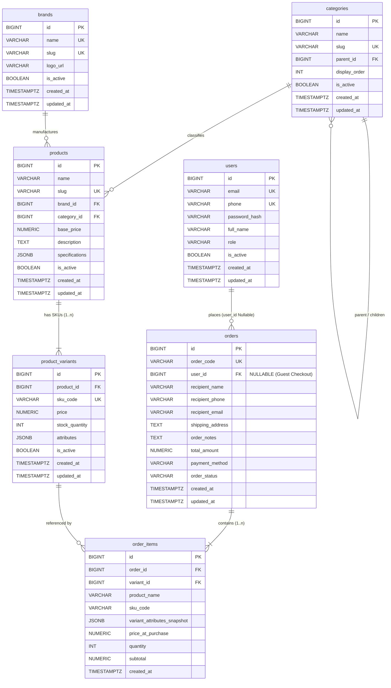

# THIẾT KẾ CƠ SỞ DỮ LIỆU VẬT LÝ — SHOPVDK (PHYSICAL DATABASE DESIGN)

> **Mã tài liệu:** DES-01  
> **Trạng thái:** Bản thảo phê duyệt (Draft)  
> **Giai đoạn:** Phase 03 — System Design & Architecture  
> **Dự án:** ShopVDK - Sports E-commerce Platform  
> **Hệ quản trị CSDL:** PostgreSQL 17 (Dockerized: `shopvdk-postgres`)  

---

## 1. Sơ Đồ Thực Thể - Quan Hệ Vật Lý (Physical ERD)

Dưới đây là sơ đồ cấu trúc 7 bảng vật lý, khóa chính, khóa ngoại và các ràng buộc dữ liệu toàn vẹn:



---

## 2. Chi Tiết Các Bảng Dữ Liệu (DDL Specifications)

### 2.1 Bảng `users` (Tài khoản Người dùng)

Lưu trữ thông tin khách hàng thành viên và nhân sự quản trị hệ thống.

```sql
CREATE TABLE users (
    id BIGINT GENERATED ALWAYS AS IDENTITY PRIMARY KEY,
    email VARCHAR(150) NOT NULL,
    phone VARCHAR(20) NOT NULL,
    password_hash VARCHAR(255) NOT NULL,
    full_name VARCHAR(100) NOT NULL,
    role VARCHAR(30) NOT NULL DEFAULT 'ROLE_CUSTOMER',
    is_active BOOLEAN NOT NULL DEFAULT TRUE,
    created_at TIMESTAMPTZ NOT NULL DEFAULT CURRENT_TIMESTAMP,
    updated_at TIMESTAMPTZ NOT NULL DEFAULT CURRENT_TIMESTAMP,
    
    CONSTRAINT uq_users_email UNIQUE (email),
    CONSTRAINT uq_users_phone UNIQUE (phone),
    CONSTRAINT chk_users_role CHECK (role IN ('ROLE_CUSTOMER', 'ROLE_ADMIN'))
);

COMMENT ON TABLE users IS 'Bảng lưu trữ tài khoản người dùng và quản trị viên';
COMMENT ON COLUMN users.phone IS 'Số điện thoại 10 chữ số dùng để đăng nhập và nhận hàng';
COMMENT ON COLUMN users.role IS 'Phân quyền bảo mật Spring Security';
```

---

### 2.2 Bảng `categories` (Danh mục Cầu Lông Đa Cấp)

Hỗ trợ phân cấp cây danh mục vô hạn qua khóa ngoại tự tham chiếu `parent_id`.

```sql
CREATE TABLE categories (
    id BIGINT GENERATED ALWAYS AS IDENTITY PRIMARY KEY,
    name VARCHAR(100) NOT NULL,
    slug VARCHAR(120) NOT NULL,
    parent_id BIGINT,
    display_order INT NOT NULL DEFAULT 0,
    is_active BOOLEAN NOT NULL DEFAULT TRUE,
    created_at TIMESTAMPTZ NOT NULL DEFAULT CURRENT_TIMESTAMP,
    updated_at TIMESTAMPTZ NOT NULL DEFAULT CURRENT_TIMESTAMP,
    
    CONSTRAINT uq_categories_slug UNIQUE (slug),
    CONSTRAINT fk_categories_parent FOREIGN KEY (parent_id) 
        REFERENCES categories(id) ON DELETE RESTRICT
);

COMMENT ON TABLE categories IS 'Cây danh mục hàng hóa (Cầu lông -> Vợt, Giày, Áo quần...)';
COMMENT ON COLUMN categories.parent_id IS 'Khóa ngoại trỏ đến danh mục cha, NULL là danh mục gốc';
```

---

### 2.3 Bảng `brands` (Thương Hiệu Thể Thao)

Quản lý danh sách các nhà sản xuất cầu lông chính hãng.

```sql
CREATE TABLE brands (
    id BIGINT GENERATED ALWAYS AS IDENTITY PRIMARY KEY,
    name VARCHAR(100) NOT NULL,
    slug VARCHAR(120) NOT NULL,
    logo_url VARCHAR(500),
    is_active BOOLEAN NOT NULL DEFAULT TRUE,
    created_at TIMESTAMPTZ NOT NULL DEFAULT CURRENT_TIMESTAMP,
    updated_at TIMESTAMPTZ NOT NULL DEFAULT CURRENT_TIMESTAMP,
    
    CONSTRAINT uq_brands_name UNIQUE (name),
    CONSTRAINT uq_brands_slug UNIQUE (slug)
);

COMMENT ON TABLE brands IS 'Danh sách các hãng sản xuất (Yonex, Victor, Lining...)';
```

---

### 2.4 Bảng `products` (Sản Phẩm Cha)

Đại diện cho mặt hàng trừu tượng, chứa thông số kỹ thuật động trong cột `specifications JSONB`.

```sql
CREATE TABLE products (
    id BIGINT GENERATED ALWAYS AS IDENTITY PRIMARY KEY,
    name VARCHAR(255) NOT NULL,
    slug VARCHAR(280) NOT NULL,
    brand_id BIGINT NOT NULL,
    category_id BIGINT NOT NULL,
    base_price NUMERIC(15, 2) NOT NULL,
    description TEXT,
    specifications JSONB NOT NULL DEFAULT '{}'::jsonb,
    is_active BOOLEAN NOT NULL DEFAULT TRUE,
    created_at TIMESTAMPTZ NOT NULL DEFAULT CURRENT_TIMESTAMP,
    updated_at TIMESTAMPTZ NOT NULL DEFAULT CURRENT_TIMESTAMP,
    
    CONSTRAINT uq_products_slug UNIQUE (slug),
    CONSTRAINT chk_products_base_price CHECK (base_price > 0),
    CONSTRAINT fk_products_brand FOREIGN KEY (brand_id) 
        REFERENCES brands(id) ON DELETE RESTRICT,
    CONSTRAINT fk_products_category FOREIGN KEY (category_id) 
        REFERENCES categories(id) ON DELETE RESTRICT
);

COMMENT ON TABLE products IS 'Sản phẩm cha trong catalog';
COMMENT ON COLUMN products.specifications IS 'Thông số kỹ thuật động (JSONB) cho bộ lọc và hiển thị specs';
```

---

### 2.5 Bảng `product_variants` (Biến Thể SKU & Quản Lý Kho)

Đại diện cho phiên bản vật lý cụ thể mà khách hàng mua, chứa thuộc tính biến thể trong cột `attributes JSONB`.

```sql
CREATE TABLE product_variants (
    id BIGINT GENERATED ALWAYS AS IDENTITY PRIMARY KEY,
    product_id BIGINT NOT NULL,
    sku_code VARCHAR(100) NOT NULL,
    price NUMERIC(15, 2) NOT NULL,
    stock_quantity INT NOT NULL DEFAULT 0,
    attributes JSONB NOT NULL DEFAULT '{}'::jsonb,
    is_active BOOLEAN NOT NULL DEFAULT TRUE,
    created_at TIMESTAMPTZ NOT NULL DEFAULT CURRENT_TIMESTAMP,
    updated_at TIMESTAMPTZ NOT NULL DEFAULT CURRENT_TIMESTAMP,
    
    CONSTRAINT uq_product_variants_sku UNIQUE (sku_code),
    CONSTRAINT chk_product_variants_price CHECK (price > 0),
    CONSTRAINT chk_product_variants_stock CHECK (stock_quantity >= 0),
    CONSTRAINT fk_product_variants_product FOREIGN KEY (product_id) 
        REFERENCES products(id) ON DELETE CASCADE
);

COMMENT ON TABLE product_variants IS 'Biến thể SKU có tồn kho và giá bán độc lập';
COMMENT ON COLUMN product_variants.stock_quantity IS 'Số lượng tồn kho thực tế, CHECK >= 0 chống bán âm';
COMMENT ON COLUMN product_variants.attributes IS 'Thuộc tính chọn mua: size, weight, grip, color (JSONB)';
```

---

### 2.6 Bảng `orders` (Đơn Đặt Hàng & Guest Checkout)

Hỗ trợ **Guest Checkout** với `user_id NULLABLE` và lưu trữ trực tiếp Snapshot thông tin người nhận.

```sql
CREATE TABLE orders (
    id BIGINT GENERATED ALWAYS AS IDENTITY PRIMARY KEY,
    order_code VARCHAR(50) NOT NULL,
    user_id BIGINT,
    recipient_name VARCHAR(100) NOT NULL,
    recipient_phone VARCHAR(20) NOT NULL,
    recipient_email VARCHAR(150) NOT NULL,
    shipping_address TEXT NOT NULL,
    order_notes TEXT,
    total_amount NUMERIC(15, 2) NOT NULL,
    payment_method VARCHAR(30) NOT NULL,
    order_status VARCHAR(30) NOT NULL DEFAULT 'PENDING',
    created_at TIMESTAMPTZ NOT NULL DEFAULT CURRENT_TIMESTAMP,
    updated_at TIMESTAMPTZ NOT NULL DEFAULT CURRENT_TIMESTAMP,
    
    CONSTRAINT uq_orders_code UNIQUE (order_code),
    CONSTRAINT chk_orders_total CHECK (total_amount >= 0),
    CONSTRAINT chk_orders_payment CHECK (payment_method IN ('COD', 'BANK_TRANSFER')),
    CONSTRAINT chk_orders_status CHECK (order_status IN ('PENDING', 'CONFIRMED', 'SHIPPING', 'COMPLETED', 'CANCELLED')),
    CONSTRAINT fk_orders_user FOREIGN KEY (user_id) 
        REFERENCES users(id) ON DELETE SET NULL
);

COMMENT ON TABLE orders IS 'Đơn đặt hàng (hỗ trợ cả Khách vãng lai lẫn Thành viên)';
COMMENT ON COLUMN orders.user_id IS 'Khóa ngoại tới users, NULL đối với đơn hàng Guest Checkout';
COMMENT ON COLUMN orders.recipient_phone IS 'Số điện thoại nhận hàng (dùng để tra cứu công khai)';
```

---

### 2.7 Bảng `order_items` (Chi Tiết Dòng Sản Phẩm Trong Đơn)

Bảo toàn vĩnh viễn đơn giá và thông tin thuộc tính tại thời điểm chốt đơn (Historical Snapshot).

```sql
CREATE TABLE order_items (
    id BIGINT GENERATED ALWAYS AS IDENTITY PRIMARY KEY,
    order_id BIGINT NOT NULL,
    variant_id BIGINT,
    product_name VARCHAR(255) NOT NULL,
    sku_code VARCHAR(100) NOT NULL,
    variant_attributes_snapshot JSONB NOT NULL DEFAULT '{}'::jsonb,
    price_at_purchase NUMERIC(15, 2) NOT NULL,
    quantity INT NOT NULL,
    subtotal NUMERIC(15, 2) NOT NULL,
    created_at TIMESTAMPTZ NOT NULL DEFAULT CURRENT_TIMESTAMP,
    
    CONSTRAINT chk_order_items_qty CHECK (quantity > 0),
    CONSTRAINT chk_order_items_price CHECK (price_at_purchase > 0),
    CONSTRAINT chk_order_items_subtotal CHECK (subtotal > 0),
    CONSTRAINT fk_order_items_order FOREIGN KEY (order_id) 
        REFERENCES orders(id) ON DELETE CASCADE,
    CONSTRAINT fk_order_items_variant FOREIGN KEY (variant_id) 
        REFERENCES product_variants(id) ON DELETE SET NULL
);

COMMENT ON TABLE order_items IS 'Chi tiết các mặt hàng trong đơn hàng';
COMMENT ON COLUMN order_items.price_at_purchase IS 'Đơn giá bất biến tại thời điểm đặt hàng';
```

---

## 3. Chiến Lược Đánh Chỉ Mục Nâng Cao & Tối Ưu Hiệu Năng (Advanced Indexing Strategy)

Để đảm bảo đáp ứng yêu cầu **NFR-PERF-01** (thời gian phản hồi API đọc < 200ms) và loại bỏ hoàn toàn lãng phí tài nguyên ghi (Write Amplification), hệ thống áp dụng các nguyên lý lập chỉ mục chuyên sâu của PostgreSQL 17:

### 3.1 Nguyên Tắc Loại Bỏ Chỉ Mục Thừa (Zero Redundant Index Principle)
Trong PostgreSQL, khi một cột hoặc nhóm cột được khai báo với ràng buộc `PRIMARY KEY` hoặc `UNIQUE`, hệ thống **tự động ngầm định tạo một Unique B-Tree Index** tương ứng (ví dụ: `uq_users_email`, `uq_users_phone`, `uq_categories_slug`, `uq_brands_slug`, `uq_products_slug`, `uq_product_variants_sku`, `uq_orders_code`).
- **Tuyệt đối KHÔNG** viết thêm lệnh `CREATE INDEX` thủ công cho các cột đã có ràng buộc `UNIQUE`. Việc này sẽ ép Database phải duy trì 2 cây B-Tree giống hệt nhau, làm tăng gấp đôi chi phí ghi (Write I/O), phình to kích thước đĩa và lãng phí bộ nhớ đệm RAM (`shared_buffers`).
- Đối với bảng `orders`: Vì `order_code` đã là Khóa duy nhất (Unique), câu truy vấn tra cứu đơn hàng `WHERE order_code = :code AND recipient_phone = :phone` sẽ sử dụng trực tiếp Unique Index của `order_code` với độ phức tạp tối ưu $O(\log N)$ và kiểm tra `recipient_phone` trong bộ nhớ. Do đó, không cần Composite Index thừa trên `(order_code, recipient_phone)`.

### 3.2 Giải Quyết Bài Toán Cột Có Độ Phân Tán Thấp (Low Cardinality & Partial Indexing)
- Cột `is_active` mang kiểu `BOOLEAN` chỉ có 2 giá trị (`true`/`false`). Trong hệ thống E-commerce, hơn 95% dữ liệu mang giá trị `is_active = true`. Nếu đánh B-Tree Index thông thường trên toàn bộ cột `is_active`, chi phí đọc ngẫu nhiên (Random I/O) khi duyệt hàng nghìn bản ghi `true` từ Index sang Heap Tuple sẽ đắt hơn nhiều so với việc quét tuần tự (Sequential Scan). Do đó, Query Planner của PostgreSQL sẽ **bỏ qua Index và thực hiện `Seq Scan`**, biến Index này thành "chỉ mục chết" gây lãng phí tài nguyên.
- **Giải pháp tối ưu:** Áp dụng kỹ thuật **Chỉ Mục Từng Phần (Partial Index)** với mệnh đề `WHERE`. Chúng ta chỉ lập chỉ mục trên những bản ghi thỏa mãn điều kiện thực tế (chỉ lưu các sản phẩm `is_active = true` phục vụ khách hàng, hoặc chỉ lưu `is_active = false` để hỗ trợ Admin kiểm tra sản phẩm ngừng bán). Kỹ thuật này giúp kích thước Index siêu nhỏ, luôn nằm trọn trong RAM cache và không bị ảnh hưởng khi dữ liệu không thỏa điều kiện thay đổi.

---

### 3.3 Tập Lệnh Tạo Chỉ Mục Vật Lý Tối Ưu (Optimized Index DDL Script)

```sql
-- ====================================================================
-- NHÓM 1: CHỈ MỤC KHÓA NGOẠI (FOREIGN KEYS) - CHỐNG TABLE LOCK & TĂNG TỐC JOIN
-- (PostgreSQL KHÔNG tự động đánh index cho Foreign Key)
-- ====================================================================

-- 1.1 Khóa ngoại tự tham chiếu danh mục cha - con
CREATE INDEX idx_categories_parent_id ON categories(parent_id);

-- 1.2 Khóa ngoại liên kết đơn hàng với người dùng (hỗ trợ xem lịch sử mua hàng của thành viên)
CREATE INDEX idx_orders_user_id ON orders(user_id) WHERE user_id IS NOT NULL;

-- 1.3 Khóa ngoại chi tiết đơn hàng trỏ về đơn cha và biến thể SKU
CREATE INDEX idx_order_items_order_id ON order_items(order_id);
CREATE INDEX idx_order_items_variant_id ON order_items(variant_id);


-- ====================================================================
-- NHÓM 2: PARTIAL COMPOSITE INDEXES CHO CATALOG (TỐI ƯU GIAO DIỆN KHÁCH HÀNG)
-- Chỉ lập chỉ mục cho các sản phẩm & biến thể ĐANG MỞ BÁN (is_active = true)
-- ====================================================================

-- 2.1 Tối ưu lọc sản phẩm theo Danh mục kết hợp sắp xếp Giá (WHERE is_active = true)
CREATE INDEX idx_products_active_category_price 
ON products(category_id, base_price) 
WHERE is_active = TRUE;

-- 2.2 Tối ưu lọc sản phẩm theo Thương hiệu kết hợp sắp xếp Giá (WHERE is_active = true)
CREATE INDEX idx_products_active_brand_price 
ON products(brand_id, base_price) 
WHERE is_active = TRUE;

-- 2.3 Tối ưu nạp danh sách biến thể SKU còn hoạt động theo từng sản phẩm
CREATE INDEX idx_product_variants_active_product 
ON product_variants(product_id, price) 
WHERE is_active = TRUE;


-- ====================================================================
-- NHÓM 3: CHỈ MỤC HỖ TRỢ VẬN HÀNH & TRA CỨU ĐƠN HÀNG (OPERATIONAL INDEXES)
-- ====================================================================

-- 3.1 Tra cứu đơn hàng theo Số điện thoại người nhận (Dùng cho Guest Order Tracking & CSKH)
CREATE INDEX idx_orders_recipient_phone ON orders(recipient_phone);

-- 3.2 Tối ưu thống kê doanh thu và báo cáo Admin theo ngày đặt hàng
CREATE INDEX idx_orders_created_at_desc ON orders(created_at DESC);

-- 3.3 Partial Index cho các đơn hàng ĐANG CẦN XỬ LÝ (Pending / Confirmed / Shipping)
-- Giúp màn hình Quản trị Đơn hàng của Admin tải tức thì mà không cần quét qua lịch sử đơn cũ
CREATE INDEX idx_orders_active_processing 
ON orders(order_status, created_at DESC) 
WHERE order_status IN ('PENDING', 'CONFIRMED', 'SHIPPING');

-- 3.4 Partial Index hỗ trợ Admin lọc danh sách sản phẩm đã bị tắt bán (chiếm tỉ lệ cực nhỏ)
CREATE INDEX idx_products_inactive 
ON products(id) 
WHERE is_active = FALSE;


-- ====================================================================
-- NHÓM 4: GIN INDEXES (DÀNH CHO THUỘC TÍNH ĐỘNG JSONB & BỘ LỌC THỂ THAO 2 TẦNG)
-- ====================================================================

-- 4.1 Chỉ mục GIN jsonb_path_ops trên thông số kỹ thuật sản phẩm (balance, stiffness, play_style...)
-- Tối ưu cực đại toán tử containment: WHERE specifications @> '{"balance_point": "head_heavy"}'
CREATE INDEX idx_products_specifications_gin 
ON products USING GIN (specifications jsonb_path_ops);

-- 4.2 Chỉ mục GIN jsonb_path_ops trên thuộc tính biến thể SKU (weight, grip, shoe size...)
-- Tối ưu câu lệnh lọc: WHERE attributes @> '{"weight": "4U"}'
CREATE INDEX idx_product_variants_attributes_gin 
ON product_variants USING GIN (attributes jsonb_path_ops);
```

---

## 4. Dữ Liệu Khởi Tạo Mẫu (Seed Data Representation)

Minh họa cấu trúc JSONB thực tế lưu trong Database cho 1 cây vợt Yonex:

### Sản phẩm cha (`products`):
```json
{
  "name": "Vợt Cầu Lông Yonex Astrox 88D Pro 2024",
  "slug": "vot-cau-long-yonex-astrox-88d-pro-2024",
  "base_price": 4350000.00,
  "specifications": {
    "balance": "head-heavy",
    "stiffness": "stiff",
    "play_style": "attack",
    "game_type": "doubles",
    "player_level": "advanced",
    "max_tension_lbs": 28,
    "frame_material": "HM Graphite + CFR + Tungsten",
    "shaft_material": "HM Graphite + 2G-Namd Flex Force"
  }
}
```

### Các biến thể SKU con (`product_variants`):
```json
[
  {
    "sku_code": "YNX-AX88DP-4UG5",
    "price": 4350000.00,
    "stock_quantity": 15,
    "attributes": {
      "weight": "4U",
      "grip": "G5"
    }
  },
  {
    "sku_code": "YNX-AX88DP-3UG5",
    "price": 4350000.00,
    "stock_quantity": 5,
    "attributes": {
      "weight": "3U",
      "grip": "G5"
    }
  }
]
```
