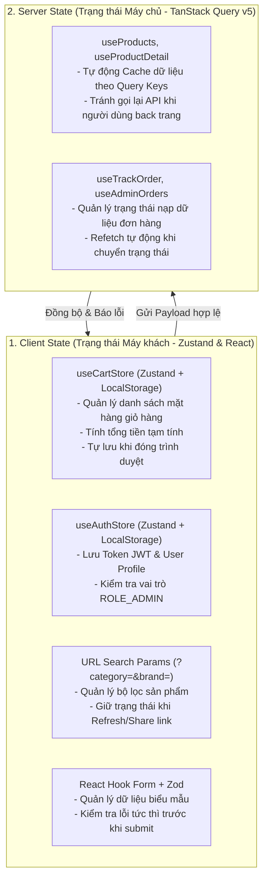
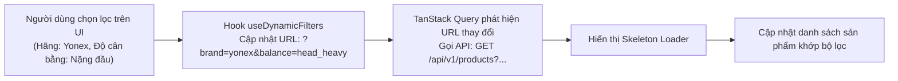

# THIẾT KẾ KIẾN TRÚC FRONTEND — SHOPVDK (FRONTEND ARCHITECTURE SPECIFICATION)

> **Mã tài liệu:** DES-04  
> **Trạng thái:** Bản thảo phê duyệt (Draft)  
> **Giai đoạn:** Phase 03 — System Design & Architecture  
> **Dự án:** ShopVDK - Sports E-commerce Platform  
> **Vai trò triển khai:** AI Frontend Developer  
> **Công nghệ Frontend:** ReactJS, TypeScript, Tailwind CSS, Vite, React Router, TanStack Query (v5), Axios, Zustand, React Hook Form, Zod  

---

## 1. Mục Tiêu & Nguyên Tắc Thiết Kế Frontend

Hệ thống giao diện người dùng của ShopVDK được thiết kế theo tiêu chuẩn hiện đại của các sàn thương mại điện tử chuyên nghiệp (tham chiếu trải nghiệm UX/UI từ ShopVNB), đảm bảo các nguyên tắc cốt lõi:

1. **Hiệu năng & Tối ưu Trải nghiệm (Performance & UX First):**
   - Loại bỏ hoàn toàn hiện tượng giật giật giao diện (Cumulative Layout Shift — CLS) bằng việc áp dụng Skeleton Loaders đồng bộ.
   - Hỗ trợ tải dữ liệu thông minh với cơ chế lưu đệm (Caching & Background Refetch) từ TanStack Query.
2. **Trải nghiệm Mua sắm Liền mạch (Seamless Guest-Friendly Experience):**
   - Giỏ hàng hoạt động tức thì trên máy khách (`LocalStorage`) không yêu cầu đăng nhập.
   - Cho phép khách vãng lai hoàn tất đơn hàng trong 1 bước duy nhất (1-Step Checkout) và tra cứu tiến độ vận chuyển công khai tại `/orders/track`.
3. **Bộ lọc Sản phẩm Thể thao 2 Tầng Linh hoạt (Dynamic 2-Tier Sport Filters):**
   - Đồng bộ toàn bộ trạng thái bộ lọc (Thương hiệu, Danh mục, Khoảng giá, Điểm cân bằng, Độ cứng, Lối chơi) lên URL Search Params (`?brand=yonex&balance=head_heavy`) giúp người dùng dễ dàng lưu bookmark hoặc chia sẻ liên kết tìm kiếm.
4. **An toàn Kiểu dữ liệu & Fail-Fast từ Client (Strict Typing & Client-Side Validation):**
   - Sử dụng 100% TypeScript cho toàn bộ Components, Hooks và API Services.
   - Kiểm tra hợp lệ dữ liệu Form bằng `Zod` trước khi gửi Request, đồng nhất hoàn toàn với luật Jakarta Bean Validation của Backend.
5. **Đầy đủ 4 Trạng thái Giao diện (Mandatory 4 UI States):**
   - Mọi màn hình và thành phần dữ liệu đều bắt buộc xử lý đủ: **Loading (Đang nạp)**, **Success (Thành công)**, **Empty (Rỗng/Không có dữ liệu)**, và **Error (Lỗi kèm nút thử lại)**.

---

## 2. Tổ Chức Cây Thư Mục Dự Án (Project Folder Structure)

Mã nguồn Frontend đặt tại thư mục `frontend/` được cấu trúc theo tính năng và tính module cao:

```text
d:\Dev\shopvdk\frontend\src
│
├── App.tsx                       # Cấu hình Providers (TanStack Query, Router, Toast)
├── main.tsx                      # Entry point khởi tạo React DOM
├── index.css                     # Cấu hình Tailwind CSS Directive & Global Styles
│
├── api/                          # Tầng giao tiếp HTTP với Backend
│   ├── apiClient.ts              # Cấu hình Axios Instance & Interceptors (JWT Bearer)
│   ├── authApi.ts                # Các hàm gọi API xác thực (login, register, getMe)
│   ├── catalogApi.ts             # Các hàm gọi API danh mục, thương hiệu, sản phẩm
│   └── orderApi.ts               # Các hàm gọi API đặt hàng, tra cứu đơn
│
├── assets/                       # Ảnh tĩnh, icon, biểu tượng thể thao
│
├── components/                   # Thành phần giao diện dùng chung
│   ├── common/                   # Các UI Nguyên tử (Atomic Controls)
│   │   ├── Button.tsx            # Nút bấm chuẩn có trạng thái Loading Spinner
│   │   ├── Input.tsx             # Ô nhập liệu chuẩn hiển thị lỗi Validation
│   │   ├── Badge.tsx             # Nhãn trạng thái (Còn hàng, Hết hàng, Tag giảm giá)
│   │   ├── Modal.tsx             # Hộp thoại xác nhận / Popup
│   │   └── Skeleton.tsx          # Khung xương giả lập nội dung khi tải dữ liệu
│   │
│   ├── feedback/                 # Thành phần phản hồi trạng thái
│   │   ├── EmptyState.tsx        # Màn hình rỗng khi không có dữ liệu kèm Call-to-action
│   │   ├── ErrorAlert.tsx        # Cảnh báo lỗi kèm nút "Thử lại" (Retry)
│   │   └── LoadingOverlay.tsx    # Lớp phủ mờ khi đang submit đơn hàng
│   │
│   ├── layout/                   # Bộ khung giao diện chính
│   │   ├── Header.tsx            # Thanh điều hướng trên cùng, tìm kiếm nhanh & Giỏ hàng
│   │   ├── Navbar.tsx            # Danh mục thể thao đa cấp (Vợt, Giày, Quần áo...)
│   │   ├── Footer.tsx            # Thông tin liên hệ, cam kết chính hãng, chính sách đổi trả
│   │   ├── Breadcrumb.tsx        # Đường dẫn điều hướng phân cấp trang
│   │   ├── CustomerLayout.tsx    # Layout bọc các trang mua sắm công khai
│   │   └── AdminLayout.tsx       # Layout khu vực quản trị viên với Sidebar
│   │
│   └── features/                 # Các thành phần nghiệp vụ chuyên biệt
│       ├── catalog/              # Thành phần hiển thị sản phẩm
│       │   ├── ProductCard.tsx   # Thẻ sản phẩm với giá, thương hiệu, thông số
│       │   ├── FilterSidebar.tsx # Cột lọc đa tiêu chí (Giá, Hãng, Điểm cân bằng...)
│       │   └── VariantPicker.tsx # Khối chọn biến thể SKU (Size, Màu, Trọng lượng)
│       ├── cart/                 # Thành phần giỏ hàng
│       │   ├── CartDrawer.tsx    # Ngăn kéo giỏ hàng trượt từ phải sang (Mini-cart)
│       │   └── CartItemRow.tsx   # Dòng sản phẩm trong giỏ hàng (tăng giảm số lượng)
│       └── order/                # Thành phần đơn hàng
│           ├── OrderStatusTimeline.tsx # Dòng thời gian tiến độ đơn hàng (State Machine)
│           └── OrderSummaryCard.tsx    # Khối tóm tắt tiền hàng, phí ship
│
├── hooks/                        # Custom React Hooks
│   ├── useAuth.ts                # Hook quản lý trạng thái đăng nhập & phân quyền
│   ├── useCart.ts                # Hook tương tác giỏ hàng (Thêm, Xóa, Cập nhật)
│   ├── useDebounce.ts            # Hook hoãn thời gian tìm kiếm từ khóa
│   └── useDynamicFilters.ts      # Hook đồng bộ bộ lọc thể thao với URL Search Params
│
├── pages/                        # Màn hình trang hoàn chỉnh
│   ├── public/                   # Trang công khai dành cho khách hàng
│   │   ├── HomePage.tsx          # Trang chủ: Banner, Sản phẩm nổi bật, Hàng mới về
│   │   ├── ProductListingPage.tsx# Trang danh sách & bộ lọc sản phẩm chuyên sâu
│   │   ├── ProductDetailPage.tsx # Trang chi tiết sản phẩm, chọn biến thể & mô tả
│   │   ├── CartPage.tsx          # Trang xem toàn bộ giỏ hàng
│   │   ├── CheckoutPage.tsx      # Trang 1-bước thanh toán (Guest & Thành viên)
│   │   ├── OrderSuccessPage.tsx  # Trang thông báo đặt hàng thành công kèm mã tra cứu
│   │   ├── OrderTrackPage.tsx    # Trang tra cứu đơn hàng công khai bằng Mã + SĐT
│   │   ├── LoginPage.tsx         # Trang đăng nhập (Email/SĐT + Password)
│   │   └── RegisterPage.tsx      # Trang đăng ký thành viên mới
│   │
│   ├── customer/                 # Trang dành cho khách hàng đã đăng nhập
│   │   ├── CustomerProfilePage.tsx # Xem và sửa thông tin cá nhân
│   │   └── CustomerOrdersPage.tsx  # Lịch sử và chi tiết các đơn hàng đã đặt
│   │
│   └── admin/                    # Khu vực quản trị viên (ROLE_ADMIN)
│       ├── AdminDashboardPage.tsx  # Bảng điều khiển thống kê doanh số & đơn chờ duyệt
│       ├── AdminOrdersPage.tsx     # Danh sách & xử lý chuyển trạng thái đơn hàng
│       ├── AdminProductsPage.tsx   # Quản lý danh sách sản phẩm & biến thể SKU
│       └── AdminProductFormPage.tsx# Biểu mẫu tạo mới / Sửa sản phẩm & thông số
│
├── routes/                       # Quản lý bộ định tuyến (Router)
│   ├── AppRoutes.tsx             # Cây định tuyến chính
│   ├── ProtectedRoute.tsx        # Guard bảo vệ trang khách hàng thành viên
│   └── AdminRoute.tsx            # Guard bảo vệ trang quản trị viên
│
├── stores/                       # Quản lý trạng thái Client toàn cục (Zustand)
│   ├── useCartStore.ts           # Store lưu trữ giỏ hàng (tự động đồng bộ LocalStorage)
│   └── useAuthStore.ts           # Store lưu trữ Token JWT và Profile người dùng
│
├── types/                        # Khai báo kiểu dữ liệu TypeScript (Khớp 100% API DTOs)
│   ├── api.types.ts              # ApiResponse<T>, PageResponse<T>, ApiErrorResponse
│   ├── auth.types.ts             # LoginPayload, RegisterPayload, UserProfile
│   ├── catalog.types.ts          # Product, ProductVariant, Brand, Category, FilterParams
│   └── order.types.ts            # Order, OrderItem, GuestCheckoutPayload, OrderStatus
│
└── utils/                        # Hàm tiện ích dùng chung
    ├── formatters.ts             # formatCurrencyVND(4200000) -> "4.200.000 ₫"
    ├── dateUtils.ts              # formatDateToLocale, formatRelativeTime
    └── constants.ts              # Danh sách hằng số trạng thái, URL mặc định
```

---

## 3. Kiến Trúc Quản Lý Trạng Thái (State Management Strategy)

Để giữ mã nguồn tinh gọn và tránh tình trạng lạm dụng biến toàn cục, hệ thống phân chia ranh giới rạch ròi giữa 2 loại trạng thái:



### 3.1 Trạng thái Giỏ Hàng Khách Vãng Lai (`useCartStore`)
- Không bắt buộc người dùng đăng nhập để mua sắm.
- Mỗi thao tác "Thêm vào giỏ hàng" lưu một đối tượng mặt hàng SKU vào mảng `items`:
  ```typescript
  interface CartItem {
    variantId: number;
    productId: number;
    productName: string;
    productSlug: string;
    skuCode: string;
    price: number;
    quantity: number;
    attributes: Record<string, any>; // ví dụ: { weight: "4U", grip: "G5" }
    thumbnailUrl: string;
    maxStock: number;
  }
  ```
- Tích hợp Middleware `persist` của Zustand để tự động lưu vào `localStorage.getItem('shopvdk_cart')`.

### 3.2 Tầng Giao Tiếp Mạng (`apiClient.ts` & TanStack Query)
- Sử dụng instance `Axios` tập trung với Interceptors:
  - **Request Interceptor:** Tự động kiểm tra `useAuthStore` để chèn Header `Authorization: Bearer <token>` nếu người dùng đã đăng nhập.
  - **Response Interceptor:** Khi nhận mã `401 Unauthorized`, tự động xóa token và chuyển hướng về trang đăng nhập nếu đang truy cập tài nguyên bảo vệ.
- Chuẩn hóa cấu trúc khóa bộ nhớ đệm (Query Key Factory):
  ```typescript
  export const productKeys = {
    all: ['products'] as const,
    lists: () => [...productKeys.all, 'list'] as const,
    list: (filters: FilterParams) => [...productKeys.lists(), filters] as const,
    details: () => [...productKeys.all, 'detail'] as const,
    detail: (slug: string) => [...productKeys.details(), slug] as const,
  };
  ```

---

## 4. Kiến Trúc Bộ Lọc Sản Phẩm Đa Tiêu Chí 2 Tầng (2-Tier Dynamic Filter Architecture)

Mô phỏng trải nghiệm tìm kiếm chuyên sâu từ trang tham chiếu `shopvnb.com`, hệ thống cung cấp giao diện lọc chuyên biệt cho các ngành hàng thể thao:



### Chi tiết các khối lọc trên giao diện:
1. **Lọc theo Danh mục & Thương hiệu:** Hỗ trợ chọn đơn hoặc đa thương hiệu (Yonex, Victor, Lining).
2. **Lọc theo Khoảng giá (Price Range Slider/Buttons):** Các mức định sẵn (Dưới 1 triệu, 1 - 2 triệu, 2 - 4 triệu, Trên 4 triệu) hoặc thanh trượt linh hoạt.
3. **Lọc theo Thông số Kỹ thuật Thể thao (Dynamic Specs Filters):**
   - **Vợt cầu lông:** Điểm cân bằng (Công / Thủ / Toàn diện), Độ cứng thân vợt, Trọng lượng (3U / 4U).
   - **Giày cầu lông:** Kích cỡ (Size 39 - 44), Phom chân (Bè / Tiêu chuẩn).
4. **Sắp xếp linh hoạt:** Giá tăng dần, Giá giảm dần, Hàng mới nhất.

---

## 5. Quy Chuẩn Xử Lý 4 Trạng Thái Giao Diện (The 4 UI States Standard)

Mọi trang danh sách hoặc màn hình tải dữ liệu đều tuân thủ cấu trúc hiển thị 4 trạng thái chuẩn mực:

```tsx
export const ProductListingContainer = () => {
  const { data, isLoading, isError, error, refetch } = useProducts(filterParams);

  // 1. TRẠNG THÁI LOADING: Hiển thị dàn khung xương giả lập
  if (isLoading) {
    return <ProductGridSkeleton count={12} />;
  }

  // 2. TRẠNG THÁI ERROR: Hiển thị cảnh báo lỗi kèm nút gọi lại
  if (isError) {
    return (
      <ErrorAlert 
        message={error?.message || "Không thể tải danh sách sản phẩm"} 
        onRetry={() => refetch()} 
      />
    );
  }

  // 3. TRẠNG THÁI EMPTY: Khi bộ lọc không có sản phẩm nào phù hợp
  if (!data?.items || data.items.length === 0) {
    return (
      <EmptyState
        title="Không tìm thấy sản phẩm phù hợp"
        description="Hãy thử điều chỉnh lại bộ lọc hoặc tìm kiếm với từ khóa khác."
        actionLabel="Đặt lại bộ lọc"
        onAction={() => resetFilters()}
      />
    );
  }

  // 4. TRẠNG THÁI SUCCESS: Hiển thị dữ liệu hoàn chỉnh
  return (
    <div>
      <ProductGrid products={data.items} />
      <PaginationBar pageData={data} />
    </div>
  );
};
```

---

## 6. Luồng Kiểm Tra Hợp Lệ Dữ Liệu Biểu Mẫu (Client-Side Fail-Fast Validation)

Để tối ưu trải nghiệm và bảo vệ hệ thống trước khi gửi HTTP Request, toàn bộ các Form tương tác (Đặt hàng, Đăng nhập, Đăng ký) đều được kiểm tra chặt chẽ bằng `Zod`:

```typescript
// Định nghĩa Schema kiểm tra đơn hàng khách vãng lai
export const guestCheckoutSchema = z.object({
  recipientName: z.string().min(2, "Họ và tên người nhận tối thiểu 2 ký tự").max(100),
  recipientPhone: z.string().regex(/^(0[3|5|7|8|9])[0-9]{8}$/, "Số điện thoại không hợp lệ (yêu cầu 10 chữ số chuẩn Việt Nam)"),
  recipientEmail: z.string().email("Địa chỉ Email không đúng định dạng").optional().or(z.literal('')),
  shippingAddress: z.string().min(10, "Địa chỉ nhận hàng chi tiết tối thiểu 10 ký tự").max(500),
  orderNotes: z.string().max(255).optional(),
  paymentMethod: z.literal("COD"),
  items: z.array(z.object({
    variantId: z.number().positive(),
    quantity: z.number().min(1, "Số lượng mua tối thiểu là 1").max(100),
  })).min(1, "Giỏ hàng của bạn đang trống"),
});

export type GuestCheckoutFormData = z.infer<typeof guestCheckoutSchema>;
```
