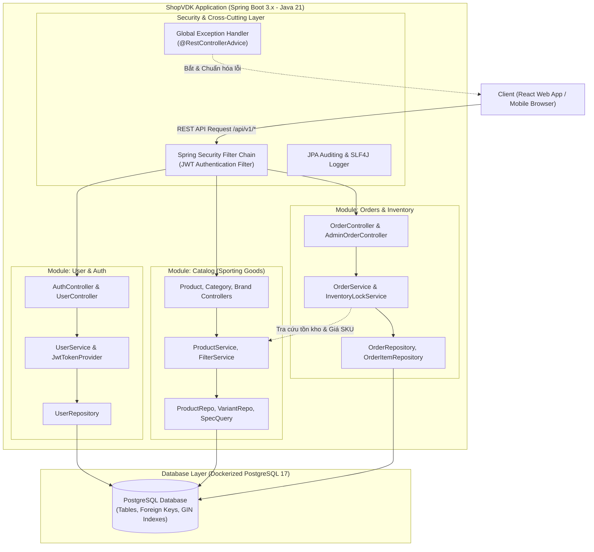
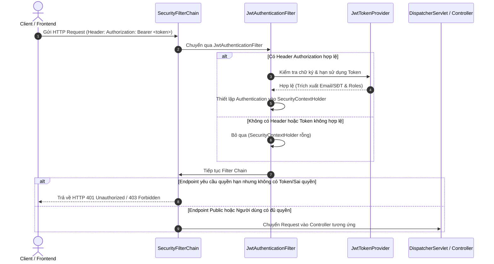
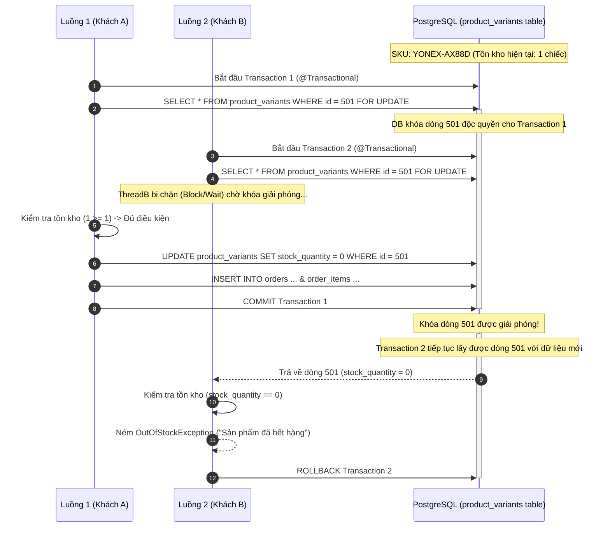

# THIẾT KẾ KIẾN TRÚC HỆ THỐNG BACKEND — SHOPVDK (SYSTEM ARCHITECTURE SPECIFICATION)

> **Mã tài liệu:** DES-03  
> **Trạng thái:** Bản thảo phê duyệt (Draft)  
> **Giai đoạn:** Phase 03 — System Design & Architecture  
> **Dự án:** ShopVDK - Sports E-commerce Platform  
> **Kiến trúc chủ đạo:** Đơn khối dạng mô-đun (Modular Monolith)  
> **Công nghệ Backend:** Java 21 LTS, Spring Boot 3.x (`jakarta.*` namespace), Spring Data JPA, Spring Security 6  

---

## 1. Tổng Quan Kiến Trúc Đơn Khối Mô-Đun (Modular Monolith)

Dự án ShopVDK áp dụng phong cách kiến trúc **Modular Monolith** (Đơn khối phân tầng theo mô-đun). Đây là sự lựa chọn tối ưu cho hệ thống E-commerce tầm trung:
- **Đơn giản hóa hạ tầng:** Toàn bộ ứng dụng chạy trong một tiến trình JVM duy nhất, loại bỏ sự phức tạp vận hành của Microservices (không cần Service Mesh, Distributed Tracing, API Gateway phức tạp).
- **Phân tách ranh giới rõ ràng (High Cohesion, Loose Coupling):** Mã nguồn được tổ chức theo từng Domain Module độc lập (`user`, `catalog`, `order`). Các mô-đun giao tiếp thông qua Service Interface công khai, không phụ thuộc chéo vào Repository của nhau.
- **Tính toàn vẹn giao dịch (ACID Transactions):** Dễ dàng thực thi các giao dịch cơ sở dữ liệu nguyên tử (Atomic Transactions) bằng Spring `@Transactional` mà không cần đến giải pháp phân tán phức tạp như Two-Phase Commit hay Saga Pattern.
- **Sẵn sàng tiến hóa:** Cấu trúc phân mô-đun nghiêm ngặt cho phép dễ dàng bóc tách thành các dịch vụ độc lập trong tương lai nếu lưu lượng truy cập tăng vọt.



---

## 2. Tổ Chức Cây Thư Mục Gói (Package Structure)

Dự án tuân thủ quy ước chuẩn của cộng đồng Spring Boot thế hệ mới, chia nhỏ theo từng nghiệp vụ (Package by Feature / Module):

```text
d:\Dev\shopvdk\backend\src\main\java\com\shopvdk
│
├── ShopvdkApplication.java               # Spring Boot Main Entry Point
│
├── common/                               # Thành phần dùng chung toàn hệ thống
│   ├── config/                           # Các cấu hình Spring Bean (CORS, OpenAPI, WebMvc)
│   │   ├── CorsConfig.java
│   │   ├── OpenApiConfig.java
│   │   └── WebMvcConfig.java
│   ├── security/                         # Bảo mật, JWT & Phân quyền
│   │   ├── SecurityConfig.java           # SecurityFilterChain định nghĩa quyền từng URL
│   │   ├── JwtTokenProvider.java         # Sinh & Giải mã Token JWT (HMAC-SHA256)
│   │   ├── JwtAuthenticationFilter.java  # Lọc Request bóc tách Bearer Token
│   │   ├── CustomUserDetailsService.java # Nạp thông tin người dùng từ Database
│   │   └── UserPrincipal.java            # Triển khai UserDetails của Spring Security
│   ├── exception/                        # Xử lý ngoại lệ tập trung
│   │   ├── GlobalExceptionHandler.java   # @RestControllerAdvice bắt lỗi toàn cục
│   │   ├── ResourceNotFoundException.java# Lỗi 404
│   │   ├── OutOfStockException.java      # Lỗi 409: Sản phẩm hết hàng (stock = 0)
│   │   ├── InsufficientStockException.java# Lỗi 409: Tồn kho không đủ (0 < stock < qty)
│   │   ├── InvalidStateTransitionException.java # Lỗi 400: Vi phạm State Machine
│   │   └── DuplicateResourceException.java # Lỗi 409: Trùng lặp Unique Constraint
│   ├── response/                         # Các lớp bọc dữ liệu chuẩn
│   │   ├── ApiResponse.java              # Envelope thành công đơn lẻ
│   │   ├── PageResponse.java             # Envelope phân trang chuẩn
│   │   └── ApiErrorResponse.java         # Envelope thông báo lỗi chuẩn RFC 7807
│   └── util/                             # Các tiện ích tĩnh (String, Date, OrderCodeGenerator)
│       └── OrderCodeGenerator.java       # Sinh mã đơn hàng dạng: VDK-YYYYMMDD-XXXXX
│
├── module/
│   ├── user/                             # Nghiệp vụ Khách hàng & Quản trị viên
│   │   ├── entity/                       # User.java
│   │   ├── repository/                   # UserRepository.java
│   │   ├── service/                      # UserService.java, UserServiceImpl.java
│   │   ├── controller/                   # AuthController.java, UserController.java
│   │   └── dto/                          # RegisterRequest, LoginRequest, AuthResponse, UserResponse
│   │
│   ├── catalog/                          # Nghiệp vụ Danh mục, Thương hiệu, Sản phẩm, Biến thể SKU
│   │   ├── entity/                       # Category.java, Brand.java, Product.java, ProductVariant.java
│   │   ├── repository/                   # CategoryRepository.java, BrandRepository.java,
│   │   │                                 # ProductRepository.java, ProductVariantRepository.java
│   │   ├── service/                      # ProductService.java, CategoryService.java, BrandService.java
│   │   ├── controller/                   # ProductController.java, CategoryController.java, BrandController.java, AdminCatalogController.java
│   │   └── dto/                          # ProductFilterRequest, ProductSummaryResponse, ProductDetailResponse, VariantResponse
│   │
│   └── order/                            # Nghiệp vụ Giỏ hàng, Đặt hàng & Vận hành Đơn hàng
│       ├── entity/                       # Order.java, OrderItem.java, OrderStatus.java (Enum)
│       ├── repository/                   # OrderRepository.java, OrderItemRepository.java
│       ├── service/                      # OrderService.java, OrderServiceImpl.java
│       ├── controller/                   # OrderController.java, AdminOrderController.java
│       └── dto/                          # GuestCheckoutRequest, CheckoutRequest, OrderResponse, OrderTrackResponse, UpdateOrderStatusRequest
```

---

## 3. Các Thành Phần Trọng Yếu Xuyên Suốt (Cross-Cutting Concerns)

### 3.1 Chuỗi Lọc Bảo Mật (Spring Security 6 & JWT Filter Chain)

Kiến trúc áp dụng cơ chế xác thực vô trạng thái (Stateless Session) sử dụng JSON Web Token:



#### Quy tắc Cấu hình Cốt lõi:
- Tắt CSRF (`csrf.disable()`) vì ứng dụng sử dụng JWT và hoàn toàn Stateless, không dùng Session Cookie.
- Thiết lập `SessionCreationPolicy.STATELESS`.
- Cấu hình phân quyền mạch lạc:
  - Cho phép truy cập công khai (`permitAll()`): `/api/v1/auth/**`, `/api/v1/categories/**`, `/api/v1/brands/**`, `/api/v1/products/**`, `/api/v1/orders/guest-checkout`, `/api/v1/orders/track`, `/swagger-ui/**`, `/v3/api-docs/**`.
  - Bắt buộc vai trò Admin (`hasRole('ADMIN')`): `/api/v1/admin/**`.
  - Khách hàng đã đăng nhập (`hasRole('CUSTOMER')`): `/api/v1/orders/checkout`, `/api/v1/customer/**`.

---

### 3.2 Cơ Chế Xử Lý Ngoại Lệ Toàn Cục (Global Exception Handling)

Tất cả các ngoại lệ phát sinh trong quá trình xử lý (từ Controller, Service đến tầng Database) đều được chặn bắt tập trung tại `@RestControllerAdvice` (`GlobalExceptionHandler`), loại bỏ hoàn toàn việc trả về trang lỗi mặc định (Whitelabel Error Page) hay lộ vết ngăn xếp hệ thống (Stacktrace):

1. **`MethodArgumentNotValidException` (Lỗi Bean Validation `@Valid`):**
   - Trả về mã HTTP `400 Bad Request`.
   - Bóc tách toàn bộ mảng lỗi `BindingResult` thành danh sách chi tiết từng trường (`field`, `rejectedValue`, `reason`).
2. **`OutOfStockException` (Khi `stock_quantity == 0`):**
   - Trả về mã HTTP `409 Conflict`.
   - Gán `errorCode: "OUT_OF_STOCK"`, thông báo "Sản phẩm đã hết hàng".
3. **`InsufficientStockException` (Khi `0 < stock_quantity < requested_quantity`):**
   - Trả về mã HTTP `409 Conflict`.
   - Gán `errorCode: "INSUFFICIENT_STOCK"`, thông báo số lượng tồn kho còn lại chính xác.
4. **`InvalidStateTransitionException`:**
   - Trả về mã HTTP `400 Bad Request`.
   - Gán `errorCode: "INVALID_STATE_TRANSITION"`.
5. **`ResourceNotFoundException`:**
   - Trả về mã HTTP `404 Not Found`.
   - Gán `errorCode: "RESOURCE_NOT_FOUND"`.
6. **`Exception` (Ngoại lệ bất ngờ chưa định nghĩa):**
   - Ghi log mức độ `ERROR` vào file log của hệ thống kèm đầy đủ Stacktrace để lập trình viên điều tra.
   - Trả về người dùng mã HTTP `500 Internal Server Error` với thông điệp thân thiện và an toàn.

---

### 3.3 Cơ Chế Khóa Dòng Dữ Liệu & Ranh Giới Giao Dịch (Concurrency & Transaction Management)

Để đảm bảo tính nhất quán của dữ liệu tồn kho trong môi trường có nhiều lượt mua sắm đồng thời (Concurrent Checkouts), hệ thống sử dụng cơ chế **Pessimistic Locking** (Khóa bi quan) tại tầng Database:



#### Quy tắc Giao Dịch Cốt lõi:
- Tất cả các phương thức truy vấn dữ liệu thuần túy (Read-only) đánh dấu `@Transactional(readOnly = true)` để tối ưu hóa hiệu năng Hibernate và cho phép Database sử dụng Snapshot Read.
- Quy trình Đặt hàng (`placeOrder`) và Chuyển trạng thái Hủy đơn (`cancelOrder`) đánh dấu `@Transactional(rollbackFor = Exception.class)` nhằm đảm bảo hoặc toàn bộ dữ liệu (tạo đơn, trừ kho, lưu chi tiết) thành công, hoặc được Rollback hoàn toàn nếu xảy ra sự cố.
- **Fail-Fast trước Lock:** Kiểm tra tính hợp lệ của Payload bằng Bean Validation (`@Valid`) trước khi mở giao dịch hoặc chọc xuống DB khóa bản ghi.

---

## 4. Quản Lý Cấu Hình Môi Trường (Configuration & Profiles)

Ứng dụng Spring Boot được cấu hình theo nguyên tắc "Twelve-Factor App", tách bạch cấu hình khỏi mã nguồn:

### 4.1 Cấu trúc Tập tin `application.yml`
- `application.yml`: Chứa các cấu hình mặc định (JPA dialect, naming strategy, timezone, kích thước file upload).
- `application-dev.yml`: Kích hoạt khi chạy cục bộ (kết nối PostgreSQL container `localhost:5432`, `ddl-auto: validate`, show SQL logs).
- `application-prod.yml`: Kích hoạt trên môi trường Production (kết nối cơ sở dữ liệu qua biến môi trường Docker, tắt debug logs, bảo mật tối đa).

### 4.2 Danh mục Biến Môi Trường (Environment Variables)
Tất cả các tham số nhạy cảm đều được nạp từ biến môi trường của hệ điều hành hoặc file `.env`:
- `SPRING_DATASOURCE_URL`: `jdbc:postgresql://localhost:5432/shopvdk_db`
- `SPRING_DATASOURCE_USERNAME`: Tên người dùng CSDL (từ `.env`)
- `SPRING_DATASOURCE_PASSWORD`: Mật khẩu CSDL (từ `.env`)
- `JWT_SECRET_KEY`: Khóa bí mật tối thiểu 256-bit (từ `.env`)
- `JWT_EXPIRATION_MS`: Thời hạn token (mặc định: `86400000` = 24h)
- `SERVER_PORT`: Cổng dịch vụ Backend (mặc định: `8080`)
