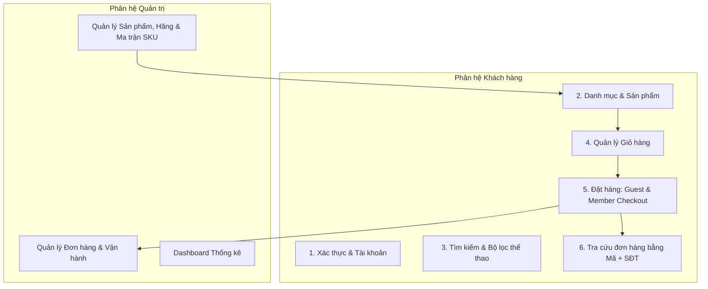
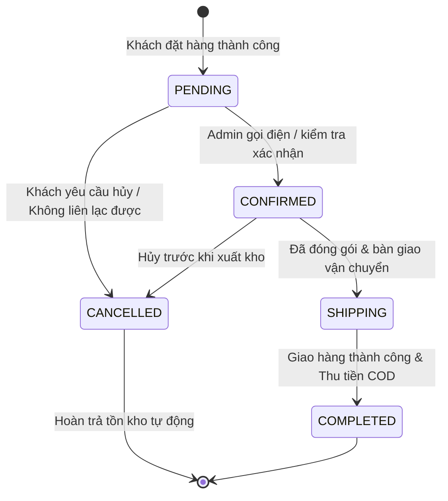

# YÊU CẦU CHỨC NĂNG CHI TIẾT — SHOPVDK (FUNCTIONAL REQUIREMENTS)

> **Mã tài liệu:** REQ-03  
> **Trạng thái:** Bản thảo phê duyệt (Draft)  
> **Giai đoạn:** Phase 01 — Discovery & Requirement Analysis  
> **Dự án:** ShopVDK - Sports E-commerce Platform  

---

## 1. Tổng quan Kiến trúc Chức năng

Hệ thống ShopVDK được cấu thành từ 6 phân hệ nghiệp vụ chính:

---

## 2. Chi tiết Yêu cầu Chức năng (Functional Modules)

### MODULE 1: XÁC THỰC VÀ PHÂN QUYỀN (FR-AUTH)

- **FR-AUTH-01: Đăng ký tài khoản Khách hàng (Register)**
  - Người dùng có thể đăng ký bằng Email, Mật khẩu, Họ tên, Số điện thoại.
  - Mật khẩu phải được băm bảo mật (BCrypt) trước khi lưu trữ.
  - Phân quyền mặc định là `ROLE_CUSTOMER`.
- **FR-AUTH-02: Đăng nhập & Cấp Token (Login)**
  - Đăng nhập bằng Email/Tài khoản và Mật khẩu.
  - Trả về JSON Web Token (JWT) cho các yêu cầu cần xác thực.
- **FR-AUTH-03: Đăng nhập Quản trị (Admin Login)**
  - Cổng đăng nhập bảo mật riêng cho nhân sự có quyền `ROLE_ADMIN`.
- **FR-AUTH-04: Nguyên tắc Tự do Mua sắm (CRITICAL)**
  - **Hệ thống TUYỆT ĐỐI KHÔNG ép buộc người dùng phải đăng nhập mới được mua hàng.** Khách vãng lai có quyền xem hàng, chọn biến thể, thêm giỏ và tiến hành Đặt hàng (Guest Checkout) hoàn toàn bình thường.

---

### MODULE 2: DANH MỤC, THƯƠNG HIỆU & SẢN PHẨM (FR-CATALOG)

- **FR-CATALOG-01: Quản lý Danh mục (MVP Scope: Chuyên sâu Cầu Lông)**
  - **Phạm vi MVP:** Tập trung duy nhất vào hệ sinh thái sản phẩm Cầu lông (Badminton):
    - Cây danh mục cấp 1: *Cầu lông*
    - Nhóm sản phẩm cấp 2: *Vợt cầu lông, Giày cầu lông, Quần áo cầu lông, Túi & Balo cầu lông, Cước căng vợt, Phụ kiện cầu lông*.
  - **Khả năng mở rộng (Post-MVP):** Cấu trúc bảng `categories` hỗ trợ phân cấp cha - con (`parent_id`) không giới hạn, sẵn sàng mở rộng sang *Tennis*, *Pickleball* sau khi hoàn thành MVP mà không cần thay đổi cấu trúc bảng hay code logic.
- **FR-CATALOG-02: Quản lý Thương hiệu (Brands)**
  - Danh sách các hãng cầu lông chính hãng: Yonex, Victor, Lining, Mizuno, Apacs, Kumpoo, Kawasaki, VS (Venson)...
- **FR-CATALOG-03: Quản lý Ma trận Biến thể Sản phẩm (Product Variants & SKUs)**
  - Một sản phẩm cha (Product) có nhiều biến thể con (Product Variants / SKUs):
    - **Vợt cầu lông:** Biến thể theo *Trọng lượng / Chu vi cán* (`3U/G5`, `4U/G5`, `4U/G6`).
    - **Giày cầu lông:** Biến thể theo *Size giày EU* (36, 37, 38, 39, 40, 41, 42, 43, 44, 45).
    - **Quần áo cầu lông:** Biến thể theo *Size* (S, M, L, XL, XXL) và *Màu sắc*.
    - **Cước & Phụ kiện:** Biến thể theo *Màu sắc cước/quấn cán* hoặc *Quy cách đóng gói* (Vỉ đơn / Cuộn lớn).
- **FR-CATALOG-04: Quản lý Tồn kho Biến thể (SKU Inventory)**
  - Mỗi SKU biến thể có: Mã SKU riêng biệt, Giá bán riêng (nếu có chênh lệch), Số lượng tồn kho (`quantity`).
  - Khi một biến thể hết hàng, hệ thống hiển thị "Tạm hết hàng" cho riêng biến thể đó, các biến thể khác vẫn bán bình thường.
- **FR-CATALOG-05: Thông số Kỹ thuật Thể thao (Sports Technical Specs)**
  - Bảng thông số chi tiết hỗ trợ người chơi thể thao ra quyết định:
    - Vợt: Điểm cân bằng (Nặng đầu / Cân bằng / Nhẹ đầu), Độ cứng thân vợt (Dẻo / Trung bình / Cứng), Mức căng tối đa (`lbs`).

---

### MODULE 3: TÌM KIẾM VÀ BỘ LỌC (FR-SEARCH)

> [!NOTE]
> **Nguồn dữ liệu:** Bộ lọc bên dưới được điều tra thực tế từ cấu trúc sidebar của ShopVNB (shopvnb.com) qua tìm kiếm web ngày 13/11/2026, sau đó được tinh chỉnh cho phù hợp phạm vi ShopVDK (loại bỏ bộ lọc chi nhánh, bổ sung cho Pickleball & Tennis theo đặc thù ngành).

- **FR-SEARCH-01: Tìm kiếm theo từ khóa (Text Search)**
  - Tìm kiếm theo tên sản phẩm, thương hiệu hoặc mã sản phẩm.
  - Xử lý trạng thái rỗng (Empty State) khi không tìm thấy kết quả phù hợp.

- **FR-SEARCH-02: Bộ lọc Động theo Danh mục (Category-specific Dynamic Filtering)**
  - **Nguyên tắc nghiệp vụ:** Khi khách hàng duyệt vào một Danh mục cụ thể, thanh bộ lọc (Filter Sidebar) sẽ tự động thay đổi để chỉ hiển thị các tiêu chí lọc phù hợp với đặc thù kỹ thuật của danh mục đó. Không được hiển thị các tiêu chí không liên quan (ví dụ: không hiện "Độ cứng đũa vợt" khi khách đang xem Giày).

---

#### A. BỘ LỌC DÙNG CHUNG (Áp dụng cho MỌI danh mục)

| STT | Nhóm lọc | Giá trị | Ghi chú |
|---|---|---|---|
| 1 | **Thương hiệu** | *(Tùy danh mục — xem bảng riêng)* | Cho phép chọn nhiều hãng cùng lúc (multi-select) |
| 2 | **Mức giá** | Dưới 500.000đ · 500.000đ – 1 triệu · 1 – 2 triệu · 2 – 3 triệu · Trên 3 triệu | Khoảng giá phù hợp ngành thể thao VN |
| 3 | **Tình trạng hàng** | Còn hàng / Tất cả | Mặc định hiển thị tất cả |

---

#### B. BỘ LỌC VỢT CẦU LÔNG (`/categories/vot-cau-long`)

| STT | Nhóm lọc | Giá trị |
|---|---|---|
| 1 | Thương hiệu | Yonex · Victor · Lining · Mizuno · Apacs · Proace · Fleet |
| 2 | Mức giá | *(Dùng chung)* |
| 3 | **Trọng lượng (U)** | 2U (90-94g) · 3U (85-89g) · 4U (80-84g) · 5U (75-79g) |
| 4 | **Độ cứng đũa vợt** | Dẻo (Flexible) · Trung bình (Medium) · Cứng (Stiff) · Siêu cứng (Extra Stiff) |
| 5 | **Điểm cân bằng** | Nặng đầu (Thiên công) · Cân bằng (Công thủ toàn diện) · Nhẹ đầu (Thiên thủ / phản tạt) |
| 6 | **Trình độ chơi** | Người mới chơi · Chơi phong trào · Bán chuyên · Chuyên nghiệp |

---

#### C. BỘ LỌC GIÀY CẦU LÔNG (`/categories/giay-cau-long`)

| STT | Nhóm lọc | Giá trị |
|---|---|---|
| 1 | Thương hiệu | Yonex · Lining · Victor · Mizuno · Kawasaki · Kumpoo |
| 2 | Mức giá | Dưới 500.000đ · 500.000đ – 1 triệu · 1 – 2 triệu · Trên 2 triệu |
| 3 | **Size giày (EU)** | 36 · 37 · 38 · 39 · 40 · 40.5 · 41 · 42 · 42.5 · 43 · 44 · 44.5 · 45 |
| 4 | **Giới tính** | Nam · Nữ · Unisex |

---

#### D. BỘ LỌC TRANG PHỤC THỂ THAO (`/categories/ao-cau-long`, `/categories/quan-cau-long`)

| STT | Nhóm lọc | Giá trị |
|---|---|---|
| 1 | Thương hiệu | Yonex · Lining · Victor · Taro · Beyono |
| 2 | Mức giá | Dưới 200.000đ · 200.000đ – 500.000đ · 500.000đ – 1 triệu · Trên 1 triệu |
| 3 | **Giới tính** | Nam · Nữ · Unisex |
| 4 | **Size quần áo** | S · M · L · XL · XXL · XXXL |
| 5 | **Màu sắc** | Đen · Trắng · Xanh dương · Xanh lá · Đỏ · Vàng · Cam · Hồng · Tím · Xám |

---

#### E. BỘ LỌC CƯỚC CẦU LÔNG (`/categories/cuoc-cau-long`)

| STT | Nhóm lọc | Giá trị |
|---|---|---|
| 1 | Thương hiệu | Yonex · Lining · Victor · VS (Venson) · Gosen · Kizuna |
| 2 | Mức giá | Dưới 100.000đ · 100.000đ – 180.000đ · Trên 180.000đ |
| 3 | **Đường kính dây** | Siêu mỏng (0.61 – 0.65mm) · Trung bình (0.66 – 0.68mm) · Dày / Bền (0.69 – 0.70mm) |
| 4 | **Đặc tính nổi trội** | Trợ lực / Nảy tốt · Âm nổ to · Độ bền cao · Cảm giác kiểm soát · Xoáy cầu |

---

#### F. BỘ LỌC TÚI / BALO CẦU LÔNG (`/categories/tui-cau-long`)

| STT | Nhóm lọc | Giá trị |
|---|---|---|
| 1 | Thương hiệu | Yonex · Lining · Victor · Kumpoo · Mizuno |
| 2 | Mức giá | Dưới 300.000đ · 300.000đ – 700.000đ · Trên 700.000đ |
| 3 | **Loại túi** | Túi vợt 3 ngăn · Túi vợt 2 ngăn · Balo cầu lông · Túi xách đa năng |

---

#### G. BỘ LỌC PHỤ KIỆN CẦU LÔNG (`/categories/phu-kien-cau-long`)

| STT | Nhóm lọc | Giá trị |
|---|---|---|
| 1 | Thương hiệu | Yonex · Lining · Victor · VS · Kumpoo |
| 2 | Mức giá | Dưới 50.000đ · 50.000đ – 150.000đ · Trên 150.000đ |
| 3 | **Loại phụ kiện** | Quấn cán (Overgrip) · Quấn lót cán · Vớ (Tất) thể thao · Băng chặn mồ hôi · Khác |

---

#### H. BỘ LỌC DỰ PHÒNG MỞ RỘNG SAU MVP (POST-MVP: TENNIS & PICKLEBALL)
> [!NOTE]
> Các bộ lọc dưới đây **không triển khai trong MVP** để tránh Scope Creep. Tuy nhiên, nhờ thiết kế thuộc tính động bằng **PostgreSQL JSONB**, hệ thống Backend và DB hoàn toàn sẵn sàng kích hoạt các nhóm lọc này trong tương lai chỉ bằng việc thêm dữ liệu vào bảng danh mục và sản phẩm:
> - **Vợt Tennis (Giai đoạn 2):** Trọng lượng (<275g, 275-295g, >300g), Cỡ đầu vợt (<98 sq.in, 98-102 sq.in, >105 sq.in), Hãng (Wilson, Babolat, Head...).
> - **Vợt Pickleball (Giai đoạn 2):** Trọng lượng (<7.8 oz, 7.8-8.2 oz, >8.3 oz), Độ dày lõi mặt vợt (<14mm, 14-16mm), Hãng (Joola, Selkirk, Sypik...).

- **FR-SEARCH-03: Sắp xếp (Sorting)**
  - Giá tăng dần, Giá giảm dần, Mới nhất, Bán chạy nhất.

---

### MODULE 4: GIỎ HÀNG (FR-CART)

- **FR-CART-01: Giỏ hàng Khách vãng lai (Guest Cart)**
  - Lưu trữ phía Client (Local Storage) để khách chưa đăng nhập vẫn lưu được món hàng khi tải lại trang hoặc tắt trình duyệt.
- **FR-CART-02: Thao tác Giỏ hàng**
  - Thêm sản phẩm kèm biến thể (SKU) đã chọn.
  - Tăng / giảm số lượng (không cho phép chọn vượt quá tồn kho thực tế).
  - Xóa sản phẩm khỏi giỏ.
  - Tự động tính toán tổng tiền tạm tính.

---

### MODULE 5: ĐẶT HÀNG & MUA HÀNG KHÔNG CẦN ĐĂNG NHẬP (FR-ORDER) — [TRỌNG TÂM]

- **FR-ORDER-01: Luồng Mua Hàng Khách Vãng Lai (Guest Checkout)**
  - Khách hàng không cần đăng nhập hay tạo tài khoản.
  - Biểu mẫu đặt hàng chỉ yêu cầu nhập các trường thông tin giao hàng trực tiếp:
    1. **Họ và tên người nhận** (`recipient_name` - Bắt buộc)
    2. **Số điện thoại nhận hàng** (`recipient_phone` - Bắt buộc, kiểm tra định dạng SĐT Việt Nam 10 chữ số)
    3. **Địa chỉ email** (`recipient_email` - Bắt buộc để nhận thông báo đơn hàng)
    4. **Địa chỉ giao hàng** (`shipping_address` - Bắt buộc: Tỉnh/Thành phố, Quận/Huyện, Phường/Xã, Số nhà/Tên đường)
    5. **Ghi chú đơn hàng** (`order_notes` - Tùy chọn)
- **FR-ORDER-02: Luồng Mua Hàng Thành Viên (Member Checkout)**
  - Khách đã đăng nhập hệ thống sẽ tự động điền sẵn Họ tên, SĐT và Địa chỉ mặc định từ hồ sơ cá nhân.
- **FR-ORDER-03: Tạo Mã Đơn Hàng Duy Nhất (Order Code)**
  - Hệ thống tự sinh mã đơn hàng thân thiện cho con người, ví dụ: `VDK-20261112-8921` (không dùng số ID tuần tự lộ dữ liệu).
- **FR-ORDER-04: Phương thức Thanh toán (Payment Methods)**
  - **COD (Cash on Delivery):** Thanh toán tiền mặt khi nhận hàng (phổ biến nhất).
  - **Chuyển khoản ngân hàng trực tiếp (Bank Transfer):** Hiển thị thông tin tài khoản ngân hàng, mã QR và Cú pháp chuyển khoản chứa `Order Code`.
- **FR-ORDER-05: Trừ Kho Thời Gian Thực (Inventory Reservation)**
  - Ngay khi đặt hàng thành công, số lượng tồn kho của các biến thể (SKUs) tương ứng trong đơn hàng sẽ lập tức bị trừ tương ứng.
- **FR-ORDER-06: Vòng đời & Trạng thái Đơn hàng (Order State Machine)**

- **FR-ORDER-07: Cơ chế Hoàn trả Tồn kho khi Hủy Đơn (Stock Release)**
  - Khi đơn hàng chuyển sang trạng thái `CANCELLED`, hệ thống tự động cộng hoàn lại số lượng tồn kho cho các SKU tương ứng.

---

### MODULE 6: TRA CỨU ĐƠN HÀNG KHÔNG CẦN TOKEN (FR-TRACKING)

- **FR-TRACKING-01: Tra cứu đơn hàng công khai (Public Order Lookup)**
  - Khách vãng lai truy cập trang `/orders/track`.
  - Nhập **Mã đơn hàng** (`orderCode`) + **Số điện thoại nhận hàng** (`recipientPhone`).
  - Hệ thống kiểm tra cặp điều kiện: nếu khớp chính xác, trả về chi tiết đơn hàng (Danh sách món, tổng tiền, trạng thái đơn hiện tại).
  - **Không yêu cầu bất kỳ Authentication Token nào**, đảm bảo tính bảo mật vừa đủ mà tiện lợi tối đa cho khách vãng lai.
- **FR-TRACKING-02: Tra cứu cho Khách hàng thành viên**
  - Khách hàng đã đăng nhập có thể xem toàn bộ lịch sử đơn hàng của mình tại trang `/account/orders`.

---

### MODULE 7: QUẢN TRỊ CỬA HÀNG (FR-ADMIN)

- **FR-ADMIN-01: Bảng số liệu Tổng quan (Dashboard)**
  - Tổng số đơn chờ duyệt, tổng doanh thu trong ngày/tháng, sản phẩm sắp hết hàng.
- **FR-ADMIN-02: Quản lý Đơn hàng**
  - Xem danh sách đơn, lọc theo trạng thái (`PENDING`, `CONFIRMED`, `SHIPPING`, `COMPLETED`, `CANCELLED`).
  - Xem chi tiết từng đơn hàng, thay đổi trạng thái đơn, ghi chú lý do nếu hủy đơn.
- **FR-ADMIN-03: Quản lý Danh mục & Sản phẩm**
  - Thêm/sửa danh mục, thêm sản phẩm mới kèm danh sách biến thể SKU và số lượng kho ban đầu.

---

## 3. Ràng Buộc Thiết Kế Cơ Sở Dữ Liệu (Database Design Constraints)

### 3.1 Bảng `orders` (Quản lý Đơn hàng & Guest Checkout)
> [!IMPORTANT]
> **Yêu cầu kỹ thuật bắt buộc cho Bảng `orders` ở Phase 03:**
> 1. **Cột `user_id` PHẢI là `NULLABLE`:**
>    - Khi đơn hàng do Khách vãng lai đặt (Guest): `user_id = NULL`.
>    - Khi đơn hàng do Thành viên đặt (Member): `user_id = <ID của user>`.
> 2. **Lưu trữ trực tiếp thông tin giao hàng dạng Snapshot trên bảng `orders`:**
>    - `recipient_name VARCHAR(100) NOT NULL`
>    - `recipient_phone VARCHAR(20) NOT NULL`
>    - `recipient_email VARCHAR(150) NOT NULL`
>    - `shipping_address TEXT NOT NULL`
>    - `order_notes TEXT NULL`
>    - `order_code VARCHAR(50) UNIQUE NOT NULL`
>    - `order_status VARCHAR(30) NOT NULL`
>    - `payment_method VARCHAR(30) NOT NULL`
>    - `total_amount NUMERIC(15, 2) NOT NULL`
> 3. **Lý do kỹ thuật (Data Snapshot):** Không được phụ thuộc vào bảng `users` để lấy địa chỉ người nhận, vì nếu sau này user đổi địa chỉ nhà, các đơn hàng trong quá khứ không được phép bị thay đổi thông tin lịch sử giao nhận.

---

### 3.2 Bảng `products` & `product_variants` (Xử lý Thuộc tính Động bằng PostgreSQL JSONB)
> [!TIP]
> **Chiến lược Kiến trúc Database cho Thuộc tính Thể thao Động ở Phase 03:**
> 1. **Vấn đề của mô hình truyền thống (Anti-patterns):**
>    - Nếu tạo riêng từng cột (`stiffness`, `weight_grip`, `shoe_size`, `string_gauge`...) trên bảng `products`, bảng sẽ bị loãng (Sparse Columns), hàng loạt cột bị `NULL` vô ích (ví dụ: sản phẩm Áo quần thì cột `max_tension_lbs` bị null).
>    - Nếu dùng mô hình **EAV (Entity-Attribute-Value)** với các bảng `attributes` và `attribute_values`, câu lệnh SQL sẽ cực kỳ nặng nề, phải `JOIN` từ 5-10 bảng chỉ để lấy thông số hiển thị hoặc lọc sản phẩm, làm giảm hiệu năng nghiêm trọng.
> 2. **Giải pháp Tối ưu: Ứng dụng kiểu dữ liệu `JSONB` của PostgreSQL 17:**
>    - Bảng `products`: Bổ sung cột **`specifications JSONB NOT NULL DEFAULT '{}'`** để lưu trữ thông số kỹ thuật động theo từng loại danh mục.
>      - *Ví dụ Vợt:* `{"balance": "Head-heavy", "stiffness": "Stiff", "max_tension": 30}`
>      - *Ví dụ Giày:* `{"surface": "Indoor / Carpet", "technology": "Power Cushion"}`
>    - Bảng `product_variants`: Bổ sung cột **`attributes JSONB NOT NULL DEFAULT '{}'`** để định nghĩa biến thể cụ thể của SKU.
>      - *Ví dụ SKU Vợt:* `{"weight": "4U", "grip": "G5"}`
>      - *Ví dụ SKU Giày:* `{"size": "41"}`
>      - *Ví dụ SKU Áo:* `{"size": "L", "color": "Navy Blue"}`
> 3. **Chiến lược Đánh Chỉ mục Tối ưu (Indexing Strategy):**
>    - Đánh **GIN Index (`jsonb_path_ops`)** trên cột `specifications` và `attributes`.
>    - Giúp câu lệnh truy vấn lọc động (sử dụng toán tử `@>` của PostgreSQL) đạt tốc độ thực thi tương đương với các cột quan hệ thông thường mà vẫn giữ cho Database Schema cực kỳ tinh gọn, linh hoạt và không cần chạy migrations mỗi khi có môn thể thao mới.
> 4. **Bảo đảm tính Mở rộng Đa môn Thể thao (Zero-Code Backend Extension):**
>    - Dù MVP chỉ chạy Cầu lông, sau này khi thêm môn Tennis (với các thuộc tính `head_size`, `unstrung_weight`) hay Pickleball (`core_thickness`), lập trình viên chỉ cần tạo thêm Category và đẩy dữ liệu JSON tương ứng vào database.
>    - **Tuyệt đối không cần viết thêm bảng mới, không cần sửa Entity Java, không cần migration DDL.** Backend Spring Boot hoàn toàn không phải sửa đổi code!

