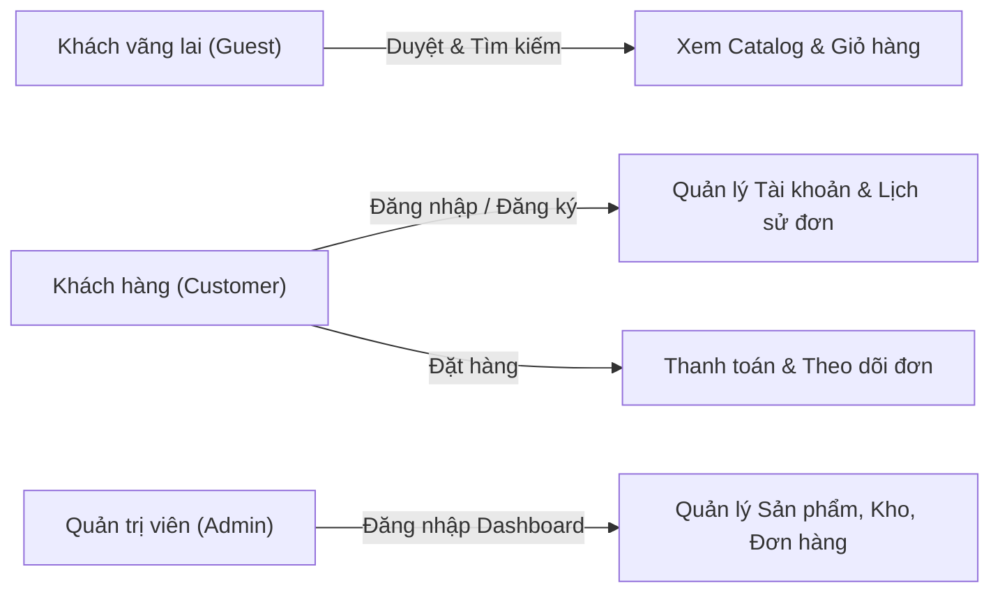

# TỔNG QUAN DỰ ÁN — SHOPVDK (PROJECT OVERVIEW)

> **Mã tài liệu:** REQ-01  
> **Trạng thái:** Bản thảo phê duyệt (Draft)  
> **Giai đoạn:** Phase 01 — Discovery & Requirement Analysis  
> **Dự án:** ShopVDK - Sports E-commerce Platform  

---

## 1. Bối cảnh & Tầm nhìn Dự án (Project Vision)

### 1.1 Giới thiệu & Định hướng Phạm vi
**ShopVDK** là nền tảng thương mại điện tử chuyên kinh doanh trang thiết bị, dụng cụ và trang phục thể thao chất lượng cao.

> [!IMPORTANT]
> **Chiến lược Phạm vi MVP (Scope Management):**
> Nhằm hạn chế rủi ro phình to phạm vi dự án (Scope Creep) và đảm bảo chất lượng kỹ thuật chuyên sâu, phiên bản **MVP (Minimum Viable Product)** sẽ **CHỈ TẬP TRUNG DUY NHẤT 1 BỘ MÔN: CẦU LÔNG (BADMINTON)** (bao gồm: Vợt, Giày, Quần áo, Balo/Túi, Cước & Phụ kiện cầu lông).
> 
> **Nguyên tắc Kiến trúc Mở (Open for Extension):**
> Dù MVP chỉ phục vụ Cầu lông, hệ thống bắt buộc phải được thiết kế theo tư duy mở (đặc biệt là ứng dụng kiểu dữ liệu `JSONB` trong PostgreSQL cho các cột thuộc tính và thông số kỹ thuật). Điều này đảm bảo sau khi hoàn thành MVP, Project Owner có thể dễ dàng mở rộng sang các môn thể thao khác (như Tennis, Pickleball) thông qua cấu hình dữ liệu mà **hoàn toàn không cần sửa đổi mã nguồn Backend**.

Dự án vừa phục vụ mục tiêu kinh doanh sản phẩm thực tế, vừa là dự án kỹ thuật thực chiến mô phỏng quy trình kỹ thuật phần mềm (Software Engineering) chuyên nghiệp theo kiến trúc **Modular Monolith**.

### 1.2 Website Tham khảo Nghiệp vụ
- **Trang tham khảo:** [ShopVNB](https://shopvnb.com/)
- **Mục đích tham khảo:**
  - Khảo sát cách tổ chức danh mục hàng hóa thể thao.
  - Phân tích luồng hành vi mua sắm đặc thù của người chơi thể thao (chọn vợt theo thông số trọng lượng `3U/4U`, chu vi cán `G5/G6`, chọn giày theo bảng size, chọn cước kèm mức căng kg/lbs).
  - Nghiên cứu bố cục giao diện (UI/UX) thân thiện với người dùng Việt Nam.
- **Nguyên tắc độc lập:** ShopVDK sở hữu nhận diện thương hiệu, thiết kế giao diện, cấu trúc cơ sở dữ liệu và toàn bộ mã nguồn độc lập. Tuyệt đối không sao chép tài nguyên ảnh độc quyền hay mã nguồn của website tham khảo.

---

## 2. Đối tượng Người dùng & Tác nhân Hệ thống (System Actors)

Hệ thống ShopVDK phục vụ 3 nhóm tác nhân chính:

### 2.1 Khách vãng lai (Guest)
- Người dùng chưa đăng nhập hệ thống.
- **Nhu cầu:**
  - Xem trang chủ, duyệt danh mục sản phẩm chuyên sâu bộ môn Cầu lông (Vợt, Giày, Quần áo, Túi/Balo, Phụ kiện).
  - Tìm kiếm sản phẩm theo từ khóa, lọc theo thương hiệu, mức giá, thông số kỹ thuật cầu lông.
  - Xem chi tiết sản phẩm, hình ảnh, bài viết đánh giá và thông số kỹ thuật.
  - Thêm sản phẩm vào giỏ hàng tạm thời (Guest Cart).
  - **Mua hàng trực tiếp không cần đăng ký tài khoản (Guest Checkout):** Chỉ cần nhập Họ tên, Số điện thoại, Địa chỉ giao hàng, Email và Ghi chú.
  - **Tra cứu đơn hàng:** Tra cứu hành trình đơn bằng `Mã đơn hàng` + `Số điện thoại` mà không cần token xác thực.

### 2.2 Khách hàng có tài khoản (Customer)
- Người dùng đã đăng ký tài khoản và xác thực qua hệ thống.
- **Nhu cầu:**
  - Quản lý hồ sơ cá nhân (họ tên, email, số điện thoại, danh sách địa chỉ giao hàng mặc định).
  - Thực hiện quy trình đặt hàng (Checkout) nhanh chóng với thông tin lưu sẵn.
  - Theo dõi trạng thái đơn hàng thời gian thực: *Chờ xác nhận -> Đang xử lý -> Đang giao hàng -> Giao thành công / Đã hủy*.
  - Xem lại lịch sử mua hàng chi tiết.

### 2.3 Quản trị viên (Administrator / Shop Manager)
- Nhân sự nội bộ quản lý cửa hàng ShopVDK.
- **Nhu cầu:**
  - Quản lý danh mục sản phẩm (Category Management - đa cấp: Môn thể thao -> Nhóm hàng -> Hãng).
  - Quản lý sản phẩm và biến thể (Product & Variant Management: quản lý tồn kho theo từng biến thể như trọng lượng cán vợt, size giày, màu áo).
  - Quản lý vòng đời đơn hàng (Order Fulfillment: tiếp nhận đơn, xác nhận, chuyển trạng thái vận chuyển, hủy đơn kèm lý do).
  - Quản lý danh sách khách hàng và phân quyền tài khoản.

---

## 3. Đặc thù Nghiệp vụ Ngành Thể Thao (Domain Specifics)

Khác với các sàn thương mại điện tử tổng hợp thông thường, ShopVDK xử lý các bài toán nghiệp vụ đặc thù:

1. **Biến thể kỹ thuật phức tạp (Technical Variants):**
   - Vợt cầu lông: Quản lý theo `Trọng lượng / Chu vi cán` (Ví dụ: `4U/G5`, `3U/G5`), độ cứng thân vợt (Stiff/Medium/Flexible), điểm cân bằng (Head-heavy/Even/Head-light).
   - Giày cầu lông: Bảng size chuẩn EU/US/CM (36 - 45).
   - Trang phục cầu lông: Bảng size (S, M, L, XL, XXL) kèm màu sắc và giới tính (Nam/Nữ).
   - Cước căng vợt: Phân loại theo đường kính dây (0.61mm - 0.70mm) và đặc tính (Trợ lực, Bền, Âm nổ).
   *(Lưu ý: Cột thuộc tính động sử dụng PostgreSQL `JSONB` sẵn sàng mở rộng các môn Tennis, Pickleball sau giai đoạn MVP mà không cần thay đổi cấu trúc bảng).*
2. **Dịch vụ phụ trợ đi kèm (Value-added Services):**
   - Đan cước vợt theo yêu cầu (chọn loại cước + số kg/lbs căng dây) — tính năng mở rộng sau MVP.
3. **Quản lý tồn kho chính xác theo từng SKU biến thể:**
   - Khi khách mua 1 cây vợt bản `4U/G5`, hệ thống chỉ trừ kho của biến thể `4U/G5`, không ảnh hưởng tới bản `3U/G5`.

---

## 4. Định hướng Kiến trúc Hệ thống

- **Mô hình kiến trúc:** **Modular Monolith**
  - Đóng gói toàn bộ backend trong một ứng dụng Spring Boot duy nhất nhưng phân chia ranh giới module rõ ràng (`user`, `catalog`, `order`, `inventory`).
  - Giao tiếp giữa Frontend (React) và Backend thông qua chuẩn **RESTful API** bảo mật bằng **JWT (JSON Web Token)**.
  - Cơ sở dữ liệu: **PostgreSQL 17** với thiết kế chuẩn hóa quan hệ (Normalized Relational Model).
- **Tiêu chuẩn chất lượng:**
  - Code sạch, dễ đọc, dễ kiểm thử (Unit test + Integration test).
  - API Contracts được tài liệu hóa rõ ràng bằng OpenAPI/Swagger trước khi tích hợp Frontend.

