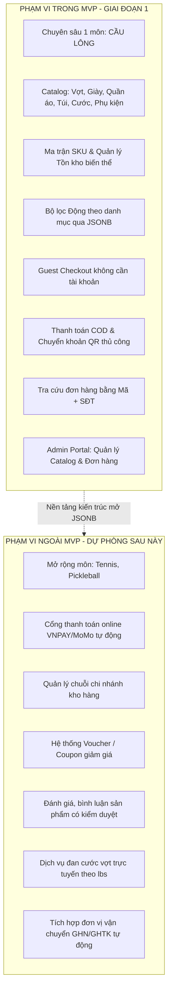

# PHẠM VI DỰ ÁN VÀ RÀNG BUỘC KỸ THUẬT — SHOPVDK (SCOPE & CONSTRAINTS)

> **Mã tài liệu:** REQ-05  
> **Trạng thái:** Bản thảo phê duyệt (Draft)  
> **Giai đoạn:** Phase 01 — Discovery & Requirement Analysis  
> **Dự án:** ShopVDK - Sports E-commerce Platform  

---

## 1. Mục đích Tài liệu

Tài liệu này xác lập "hàng rào bảo vệ" ranh giới của phiên bản sản phẩm khả dụng tối thiểu (**MVP - Minimum Viable Product**), phân định dứt khoát những gì hệ thống **SẼ LÀM** và những gì **TẠM THỜI CHƯA LÀM** ở giai đoạn 1.

Mục tiêu cốt lõi: **Loại bỏ triệt để rủi ro Scope Creep (Phình to phạm vi)**, giúp Project Owner tập trung hoàn thành trọn vẹn luồng giá trị nghiệp vụ chính của môn Cầu lông với chất lượng kỹ thuật cao nhất.

---

## 2. Bảng Phân Định Phạm vi Dự án (Scope Matrix)

---

## 3. Chi tiết Phạm vi Trong MVP (In-Scope — Phase 01 đến Phase 06)

| Nhóm Nghiệp vụ | Chi tiết Tính năng Hoạt động trong MVP |
|---|---|
| **Ngành hàng** | **Chuyên sâu Cầu Lông (Badminton)**: Vợt cầu lông, Giày cầu lông, Quần áo cầu lông, Balo/Túi cầu lông, Cước đan vợt và Phụ kiện cầu lông (quấn cán, lót cán, vớ, băng chặn mồ hôi). |
| **Xác thực & Người dùng** | - Khách vãng lai (Guest): Toàn quyền duyệt sản phẩm, lọc, tìm kiếm, giỏ hàng, đặt hàng không cần tài khoản. - Đăng ký & Đăng nhập (Customer): Quản lý hồ sơ cá nhân, đổi mật khẩu, xem lịch sử đơn hàng. - Phân quyền bảo mật: `ROLE_CUSTOMER` và `ROLE_ADMIN` qua JWT. |
| **Danh mục & Sản phẩm** | - Quản lý danh mục đa cấp: Cầu lông -> Nhóm hàng. - Quản lý thương hiệu chính hãng: Yonex, Victor, Lining, Mizuno, Apacs, Kumpoo, Kawasaki, VS... - **Ma trận biến thể SKU:** Vợt (`3U/G5, 4U/G5`), Giày (Size `36-45`), Quần áo (Size `S-XXL`, Màu sắc). - Quản lý số lượng tồn kho độc lập cho từng biến thể SKU. - **Lưu trữ thuộc tính động bằng PostgreSQL `JSONB`** kèm chỉ mục GIN. |
| **Tìm kiếm & Bộ lọc** | - Tìm kiếm văn bản theo tên/hãng/mã sản phẩm. - **Bộ lọc động thông minh theo ngữ cảnh danh mục:** Tự đổi bộ lọc theo đặc thù môn cầu lông (Trọng lượng U, Độ cứng đũa, Điểm cân bằng, Size giày, Đường kính dây cước...). |
| **Giỏ hàng** | - Giỏ hàng khách vãng lai lưu tại `localStorage`. - Tự động kiểm tra tồn kho khi tăng số lượng; chặn thêm vượt quá kho. |
| **Đặt hàng (Checkout)** | - **Guest Checkout (Bắt buộc):** Khách chỉ cần nhập Họ tên, SĐT, Email, Địa chỉ, Ghi chú là đặt hàng thành công. - **Phương thức thanh toán:**   1. COD (Thanh toán khi nhận hàng).   2. Chuyển khoản ngân hàng trực tiếp (Hiển thị STK, Ngân hàng, Mã QR chuyển khoản kèm cú pháp chứa Mã đơn hàng). - Tự động trừ kho ngay khi đặt hàng thành công. - Tự động hoàn trả tồn kho nếu đơn hàng bị hủy (`CANCELLED`). |
| **Tra cứu Đơn hàng** | - Trang `/orders/track`: Tra cứu tức thời bằng **Mã đơn hàng (`orderCode`) + Số điện thoại (`recipientPhone`)** mà **không cần đăng nhập hay Token**. |
| **Quản trị Cửa hàng (Admin)** | - Dashboard: Tổng số đơn mới, doanh thu ngày/tháng, cảnh báo sản phẩm sắp hết kho. - Quản lý Danh mục & Thương hiệu. - Quản lý Sản phẩm & tạo ma trận SKU biến thể. - Quản lý Đơn hàng: Duyệt đơn, chuyển trạng thái (*Chờ xác nhận -> Đã xác nhận -> Đang giao -> Hoàn thành / Đã hủy*). |

---

## 4. Chi tiết Phạm vi Ngoài MVP (Out-of-Scope — Tạm hoãn sang Giai đoạn sau)

Các tính năng sau đây **tuyệt đối không triển khai trong MVP** để tập trung hoàn thiện bộ khung kỹ thuật:

1. **Kinh doanh môn Tennis và Pickleball:**
   - *Chiến lược:* Giai đoạn 2. Hệ thống đã chuẩn bị sẵn kiến trúc JSONB nên khi kích hoạt chỉ cần nhập dữ liệu vào Database, không cần sửa code Backend.
2. **Tích hợp Cổng thanh toán trực tuyến tự động (VNPAY, MoMo, ZaloPay, OnePay):**
   - *Lý do hoãn:* Yêu cầu tài khoản doanh nghiệp, hợp đồng thanh toán và tích hợp Webhook/IPN phức tạp.
   - *Giải pháp thay thế MVP:* Thanh toán COD và Chuyển khoản ngân hàng hiển thị thông tin thủ công.
3. **Tích hợp API Đơn vị vận chuyển (Giao Hàng Nhanh, Giao Hàng Tiết Kiệm, Viettel Post):**
   - *Giải pháp thay thế MVP:* Admin tự quản lý cập nhật trạng thái giao hàng thủ công trên hệ thống.
4. **Quản lý Đa chi nhánh / Chuỗi cửa hàng:**
   - *Lý do hoãn:* ShopVDK là nền tảng e-commerce độc lập, không có mạng lưới hơn 80 showroom như ShopVNB. Chỉ quản lý tồn kho tại một kho trung tâm duy nhất.
5. **Hệ thống Mã giảm giá & Khuyến mãi phức tạp (Coupon / Voucher Engine):**
   - *Chiến lược:* Dành cho giai đoạn mở rộng tính năng marketing sau này.
6. **Đánh giá & Bình luận sản phẩm (Product Reviews & Ratings):**
   - *Chiến lược:* Bổ sung sau khi đã có người mua và đơn hàng thực tế hoàn thành.
7. **Dịch vụ Đan cước vợt trực tuyến (Custom Stringing Service):**
   - Tùy chọn căng dây theo số lbs và tính phụ phí đan vợt sẽ đưa vào bản nâng cấp v1.1.
8. **Hệ thống Gửi Email / SMS tự động qua dịch vụ bên thứ ba (SendGrid, Twilio, AWS SES):**
   - *Giải pháp thay thế MVP:* Khách tra cứu tiến độ đơn qua web bằng Mã đơn + SĐT.

---

## 5. Ràng Buộc Kỹ thuật và Kiến trúc (Technical Constraints)

1. **Mô hình Kiến trúc:** Bắt buộc là **Modular Monolith**. Tuyệt đối không chia tách thành Microservices, không sử dụng Message Queue (Kafka/RabbitMQ), không dùng Redis hay Elasticsearch trong giai đoạn này.
2. **Backend Framework:** Bắt buộc Java 21 LTS, Spring Boot 3.x sử dụng namespace `jakarta.*` (tuyệt đối không dùng `javax.*` cũ).
3. **Cơ sở dữ liệu:** PostgreSQL 17 (chạy Docker container đơn lẻ).
4. **Quy tắc Sở hữu Backend (Strict Backend Ownership):** Toàn bộ mã nguồn CRUD, Entities, Repositories, Services, Controllers do **Project Owner tự tay lập trình**; AI chỉ đóng vai trò Cố vấn thiết kế, giải thích logic, review code và cung cấp ví dụ nhỏ minh họa.
5. **Quy tắc Frontend:** AI chịu trách nhiệm lập trình toàn bộ phần Frontend bằng React + TypeScript + Tailwind CSS, tuân thủ nghiêm ngặt API Contract đã xác nhận từ Backend, xử lý đủ 4 trạng thái giao diện.
6. **Quy tắc Bảo mật:** Tuyệt đối không commit bí mật, mật khẩu hay credentials lên Git. Luôn sử dụng file `.env.example` và `.env`.

---

## 6. Tiêu chí Hoàn thành Phiên bản MVP (Definition of Done - DoD)

Phiên bản MVP của ShopVDK được coi là hoàn thành khi đáp ứng đủ 6 tiêu chí sau:

- [ ] **Tiêu chí 1:** Khách vãng lai có thể vào website, duyệt danh mục cầu lông, lọc sản phẩm theo thông số động (trọng lượng U, độ cứng đũa...), xem chi tiết và thêm biến thể SKU vào giỏ hàng.
- [ ] **Tiêu chí 2:** Khách vãng lai có thể hoàn tất quy trình **Guest Checkout** chỉ với Tên, SĐT, Địa chỉ, Email và chọn phương thức thanh toán mà không bị yêu cầu đăng nhập.
- [ ] **Tiêu chí 3:** Tồn kho của biến thể SKU tương ứng bị trừ chính xác ngay khi đặt hàng thành công, và được tự động hoàn lại nếu đơn hàng bị hủy.
- [ ] **Tiêu chí 4:** Khách có thể vào trang `/orders/track` nhập đúng Mã đơn + Số điện thoại để xem chi tiết và tiến độ đơn hàng.
- [ ] **Tiêu chí 5:** Admin có thể đăng nhập portal, quản lý sản phẩm / biến thể SKU, xem danh sách đơn hàng và chuyển trạng thái đơn mượt mà.
- [ ] **Tiêu chí 6:** Toàn bộ mã nguồn Backend được Project Owner tự viết và hiểu bản chất, hệ thống vượt qua các bài kiểm thử cơ bản (Unit / Integration Test).

