# SƠ ĐỒ TRANG VÀ KIẾN TRÚC THÔNG TIN — SHOPVDK (WEBSITE MAP)

> **Mã tài liệu:** REQ-02  
> **Trạng thái:** Bản thảo phê duyệt (Draft)  
> **Giai đoạn:** Phase 01 — Discovery & Requirement Analysis  
> **Dự án:** ShopVDK - Sports E-commerce Platform  

---

## 1. Sơ đồ Tổng quan Cấu trúc Trang (Information Architecture)

Hệ thống ShopVDK được tổ chức phân cấp rõ ràng thành hai phân hệ độc lập: **Storefront** (dành cho người mua sắm) và **Admin Portal** (dành cho quản trị cửa hàng).

```mermaid
graph TD
    Root["ShopVDK Application"]
    
    %% Storefront Branch
    Root --> Storefront["Phân hệ Cửa hàng (Storefront)"]
    Storefront --> Home["Trang chủ (/)"]
    Storefront --> Catalog["Danh mục & Sản phẩm"]
    Catalog --> CategoryPage["Trang danh mục (/categories/:slug)"]
    Catalog --> ProductDetail["Trang chi tiết sản phẩm (/products/:slug)"]
    Catalog --> SearchPage["Trang tìm kiếm (/search?q=...)"]
    
    Storefront --> PurchaseFlow["Luồng Mua hàng"]
    PurchaseFlow --> CartPage["Giỏ hàng (/cart)"]
    PurchaseFlow --> CheckoutPage["Đặt hàng & Thanh toán (/checkout)"]
    PurchaseFlow --> OrderSuccess["Xác nhận đơn hàng (/orders/success/:orderCode)"]
    PurchaseFlow --> OrderTracking["Tra cứu đơn hàng (/orders/track)"]
    
    Storefront --> AuthCustomer["Tài khoản & Xác thực"]
    AuthCustomer --> LoginPage["Đăng nhập (/login)"]
    AuthCustomer --> RegisterPage["Đăng ký (/register)"]
    AuthCustomer --> ProfilePage["Hồ sơ cá nhân (/account/profile)"]
    AuthCustomer --> OrderHistory["Lịch sử đơn hàng (/account/orders)"]
    
    %% Admin Branch
    Root --> Admin["Phân hệ Quản trị (Admin Portal - /admin)"]
    Admin --> AdminAuth["Đăng nhập Admin (/admin/login)"]
    Admin --> AdminDash["Dashboard Thống kê (/admin/dashboard)"]
    Admin --> AdminCatalog["Quản lý Hàng hóa"]
    AdminCatalog --> AdminCategories["Danh mục (/admin/categories)"]
    AdminCatalog --> AdminBrands["Thương hiệu (/admin/brands)"]
    AdminCatalog --> AdminProducts["Sản phẩm & Biến thể (/admin/products)"]
    AdminCatalog --> AdminProductCreate["Thêm sản phẩm mới (/admin/products/new)"]
    AdminCatalog --> AdminProductEdit["Chỉnh sửa sản phẩm (/admin/products/:id/edit)"]
    
    Admin --> AdminOrders["Quản lý Đơn hàng (/admin/orders)"]
    AdminOrders --> AdminOrderDetail["Chi tiết & Đổi trạng thái (/admin/orders/:id)"]
    
    Admin --> AdminCustomers["Quản lý Khách hàng (/admin/customers)"]
```

---

## 2. Chi tiết Phân hệ Cửa hàng (Storefront)

### 2.1 Nhóm Trang Công Khai (Public Pages)

| STT | Tên Trang | URL Path | Mục đích & Thành phần cốt lõi | Quyền truy cập |
|---|---|---|---|---|
| 1 | **Trang chủ** | `/` | - Banner quảng bá / sự kiện cầu lông lớn. - Lối tắt danh mục chuyên sâu Cầu lông: Vợt, Giày, Quần áo, Túi/Balo, Cước & Phụ kiện. - Khối sản phẩm bán chạy (Best Sellers). - Khối sản phẩm mới nhất (New Arrivals). - Giới thiệu cam kết chính hãng, chính sách bảo hành. | Công khai (Mọi người) |
| 2 | **Trang Danh mục Sản phẩm** | `/categories/:categorySlug` | - Hiển thị Breadcrumbs điều hướng đa cấp. - **Thanh lọc nâng cao (Sidebar Filter):** Hãng cầu lông (Yonex, Victor, Lining, Mizuno, Apacs...), khoảng giá, thông số kỹ thuật (trọng lượng `3U/4U/5U`, độ cứng đũa, size giày). - **Sắp xếp (Sort):** Mới nhất, giá tăng dần, giá giảm dần, bán chạy nhất. - Lưới sản phẩm (Product Grid) kèm phân trang (Pagination). | Công khai |
| 3 | **Trang Chi tiết Sản phẩm** | `/products/:productSlug` | - Thư viện ảnh sản phẩm (Gallery / Zoom). - Thông tin cơ bản: Tên, thương hiệu, mã sản phẩm, giá gốc, giá khuyến mãi. - **Bộ chọn biến thể (Variant Selector):** Chọn trọng lượng/cán (`4U/G5`), size giày (`40, 41...`), màu sắc. - Hiển thị trạng thái kho (Còn hàng / Tạm hết hàng theo biến thể). - Bảng thông số kỹ thuật chi tiết (Specs Table). - Nội dung mô tả chi tiết bài viết. - Nút CTA: **Thêm vào giỏ** & **Mua ngay**. | Công khai |
| 4 | **Trang Tìm kiếm** | `/search?q=:keyword` | - Hiển thị kết quả tìm kiếm sản phẩm theo từ khóa. - Tái sử dụng bộ lọc và sắp xếp giống trang danh mục. - Xử lý trạng thái rỗng (Empty State) khi không tìm thấy kết quả phù hợp. | Công khai |

---

### 2.2 Nhóm Trang Mua Hàng & Thanh Toán (Purchase Flow)

| STT | Tên Trang | URL Path | Mục đích & Thành phần cốt lõi | Quyền truy cập |
|---|---|---|---|---|
| 5 | **Trang Giỏ hàng** | `/cart` | - Danh sách món hàng đã chọn: ảnh, tên, biến thể (size/trọng lượng), đơn giá. - Điều chỉnh số lượng (+/-) hoặc xóa sản phẩm. - Kiểm tra tồn kho thời gian thực. - Tóm tắt chi phí (Tạm tính, phí giao hàng dự kiến). - Nút chuyển tiếp tới trang Đặt hàng (Proceed to Checkout). | Công khai (Lưu giỏ hàng Client/Server) |
| 6 | **Trang Đặt hàng & Thanh toán** | `/checkout` | - Biểu mẫu nhập thông tin người nhận: Họ tên, số điện thoại, địa chỉ nhận hàng (Tỉnh/Thành, Quận/Huyện, Phường/Xã, địa chỉ cụ thể). - Nếu đã đăng nhập: Tự động điền địa chỉ mặc định. - **Phương thức thanh toán (Payment Method):**   1. COD (Thanh toán tiền mặt khi nhận hàng).   2. Chuyển khoản ngân hàng trực tiếp (Hiển thị số tài khoản & mã nội dung chuyển khoản). - Khối ghi chú đơn hàng. - Tóm tắt đơn hàng & Nút Xác nhận Đặt hàng. | Khách vãng lai & Thành viên |
| 7 | **Trang Đặt hàng Thành công** | `/orders/success/:orderCode` | - Thông báo đặt hàng thành công. - Hiển thị mã đơn hàng (`orderCode`) để tra cứu. - Hướng dẫn chuyển khoản ngân hàng (nếu chọn phương thức Chuyển khoản). - Nút "Tiếp tục mua sắm" hoặc "Theo dõi đơn hàng". | Người vừa hoàn tất đặt hàng |
| 8 | **Trang Tra cứu Đơn hàng** | `/orders/track` | - Cho phép khách vãng lai không có tài khoản nhập `Mã đơn hàng` + `Số điện thoại` để xem tiến độ giao hàng. | Công khai |

---

### 2.3 Nhóm Trang Khách Hàng (Customer Portal)

| STT | Tên Trang | URL Path | Mục đích & Thành phần cốt lõi | Quyền truy cập |
|---|---|---|---|---|
| 9 | **Trang Đăng nhập** | `/login` | - Form đăng nhập (Email/Username + Password). - Liên kết chuyển sang Đăng ký hoặc Quên mật khẩu. | Chưa đăng nhập |
| 10 | **Trang Đăng ký** | `/register` | - Form tạo tài khoản mới: Họ tên, Email, Số điện thoại, Mật khẩu, Xác nhận mật khẩu. - Kiểm tra dữ liệu đầu vào (Validation). | Chưa đăng nhập |
| 11 | **Hồ sơ Cá nhân** | `/account/profile` | - Xem và cập nhật thông tin cá nhân. - Đổi mật khẩu. - Quản lý sổ địa chỉ giao hàng nhận sẵn (Default Address). | Yêu cầu đăng nhập (`CUSTOMER`) |
| 12 | **Lịch sử Đơn hàng** | `/account/orders` | - Danh sách đơn hàng đã mua kèm trạng thái (Chờ duyệt, Đang giao, Hoàn thành, Đã hủy). - Xem chi tiết từng đơn hàng (`/account/orders/:orderCode`). | Yêu cầu đăng nhập (`CUSTOMER`) |

---

## 3. Chi tiết Phân hệ Quản trị (Admin Portal)

Tất cả các trang thuộc phân hệ Admin đều nằm dưới tiền tố `/admin` và yêu cầu xác thực với vai trò **`ROLE_ADMIN`**.

| STT | Tên Trang | URL Path | Chức năng cốt lõi |
|---|---|---|---|
| 1 | **Đăng nhập Quản trị** | `/admin/login` | Cổng đăng nhập riêng biệt dành cho nhân sự quản trị. |
| 2 | **Bảng Điều khiển** | `/admin/dashboard` | Thống kê số lượng đơn hàng mới, tổng doanh thu ngày/tháng, số khách hàng mới, cảnh báo mặt hàng sắp hết kho (< 5 sản phẩm). |
| 3 | **Quản lý Danh mục** | `/admin/categories` | Xem cây danh mục đa cấp, thêm/sửa/ẩn danh mục theo nhóm hàng Cầu lông (Vợt, Giày, Quần áo, Túi/Balo, Phụ kiện) với thiết kế mở sẵn sàng thêm môn thể thao khác sau MVP. |
| 4 | **Quản lý Thương hiệu** | `/admin/brands` | Quản lý danh sách hãng cầu lông chính hãng (Yonex, Victor, Lining, Mizuno, Apacs, Kumpoo, Kawasaki, VS...). |
| 5 | **Danh sách Sản phẩm** | `/admin/products` | Bảng quản lý sản phẩm: tìm kiếm theo tên/SKU, lọc theo danh mục/thương hiệu, xem tổng tồn kho, chuyển đổi trạng thái hoạt động (Active/Inactive). |
| 6 | **Tạo mới Sản phẩm** | `/admin/products/new` | - Thông tin chung (Tên, hãng, danh mục, giá niêm yết, giá bán, bài viết mô tả, upload ảnh). - **Tạo ma trận biến thể (Variant Matrix):** Thêm biến thể theo thuộc tính (ví dụ vợt: `3U/G5`, `4U/G5`; giày: size `39, 40, 41...`) kèm mã SKU riêng biệt và số lượng tồn kho cho từng biến thể. |
| 7 | **Chỉnh sửa Sản phẩm** | `/admin/products/:id/edit` | Cập nhật thông tin chi tiết, chỉnh sửa giá bán và điều chỉnh số lượng tồn kho từng SKU. |
| 8 | **Quản lý Đơn hàng** | `/admin/orders` | Danh sách toàn bộ đơn đặt hàng, bộ lọc theo trạng thái đơn (Chờ xử lý, Đã xác nhận, Đang giao, Đã giao, Đã hủy). |
| 9 | **Chi tiết Đơn hàng** | `/admin/orders/:id` | Xem chi tiết sản phẩm khách đặt, thông tin giao hàng, tiền thu hộ COD. Thao tác chuyển đổi trạng thái đơn hàng và ghi chú nội bộ. |
| 10 | **Quản lý Khách hàng** | `/admin/customers` | Danh sách tài khoản người mua, xem tổng số đơn hàng đã đặt, lịch sử giao dịch và trạng thái khóa/mở tài khoản. |

---

## 4. Quy ước Đặt tên URL (URL Slug & Routing Conventions)

Để đảm bảo tính nhất quán và tối ưu hóa công cụ tìm kiếm (SEO-friendly):

1. **Định dạng ký tự (Kebab-case):** Tất cả URL đều viết chữ thường, không dấu, phân tách bằng dấu gạch ngang `-`.
   - *Đúng:* `/products/vot-cau-long-yonex-astrox-88d-pro`
   - *Sai:* `/products/Vot_Cau_Long_Yonex_Astrox_88D_Pro` hoặc `/products/votcaulong`
2. **Quy tắc phân định tài nguyên (Resource-based URLs):**
   - Danh sách tài nguyên dùng danh từ số nhiều: `/categories`, `/products`, `/orders`.
   - Chi tiết tài nguyên dùng định danh duy nhất (Slug thân thiện hoặc ID/Code): `/products/:slug`, `/orders/:orderCode`.
3. **Phân tách hoàn toàn route:**
   - Người mua: Không có tiền tố đặc biệt (`/`, `/products/...`).
   - Quản trị viên: Bắt buộc có tiền tố `/admin/...`.

